# Changelog

Changes to the game itself, newest first, with the time each went live (Honolulu time, from the commit history). Save commits (`Day NNN ...`) are the adventure log and aren't listed here.

## v1.14 - Shared Things - Oct 17 2026, 04:55 HST

- **Your finds are real now.** Signed in at dungeon.88x31.app, every item you pick up is also kept as a numbered copy in the shared item registry, the same one the other 88x31 games use.
- **INVENTORY.** Account → INVENTORY lists the items kept for you, and any of them can visit your 88x31 cLuB page. 88x31 buttons you send here show up in it too, and can be sent home.
- **Nothing changes in a run.** The bag, the items and what they do are exactly as before; the item list now comes from the shared list.

## v1.13 - Accounts - Oct 17 2026, 03:43 HST

- **Optional accounts.** At dungeon.88x31.app, the PASSWORD screen has an ACCOUNT button: make a save code or add a passkey (the same one as the other 88x31 games).
- **Your run follows you.** SAVE RUN puts it in the cloud; GET RUN on another device brings it back into the password box to load.
- **Nothing changes if you skip it.** Playing without an account works as before, and your scores are tied to your account only when you're signed in.

## v1.12.1 - Softer Edges - Oct 15 2026, 09:48 HST

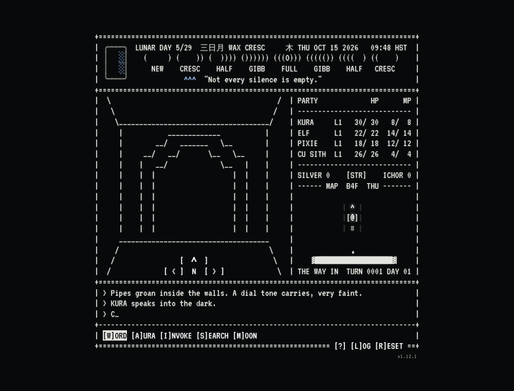

- **Party members ask questions much later.** Only after you've talked with them a good many times, and never on the first talk of the day.
- **Your answers read as actions** ("KURA waves at the moon.") and not as "KURA answers: no".
- **The gift box is tucked away.** It takes a few searches at the end of a wing to turn up, and the room hints when you're close.
- **The heat color is a gradient,** from pastel yellow through orange to red, and it only shows after an AURA read.
- **The moon view has no [ ^ ] button.**

## v1.12 - A Warm Little Room - Oct 15 2026, 09:34 HST

- **Heat has a shape now.** Dealing with a demon cools the room by a third. A room turning hot wears a little on your party's patience, and that is the only thing that does.
- **Patience bottoms out calm, not upset.** Nobody snaps, lashes out or leaves anymore. A party member who has had enough just goes quiet and content, with new lines for it.
- **Safe or gamble.** Now and then a choice comes with a sure thing beside a bigger one that only sometimes lands: under the moon, in a hot room, at a worn wall, and when a demon holds out a wrapped gift. A miss gives nothing, and says something silly.
- **AURA shows the heat.** After you read a room, the brackets around it (and a little of the rooms next to it) warm from yellow to red, then fade after a while.
- **Breath comes back faster, and it's harder to run out.** Steps and talking cost less.
- **"KURA falls into step" is a line in the log, not a popup.**

## v1.11 - Room to Breathe - Oct 15 2026, 07:31 HST

- **Breath comes back faster.**
- **It's harder to run out of breath.** Steps and talking cost less.
- **"KURA falls into step" is a line in the log, not a popup.**

## v1.10 - A Box in the Corner - Oct 15 2026, 07:10 HST

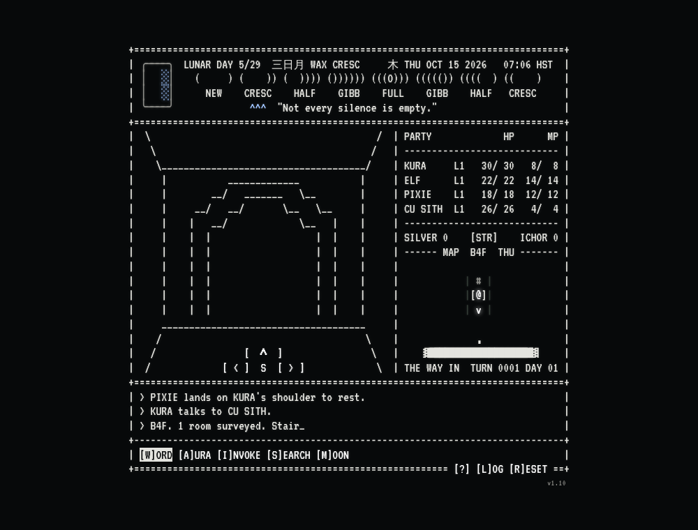

- **The end of a wing has a small box.** Take what the last visitor left, and leave something small of your own for the next one. Scratch marks on the wall hint at which way others went.
- **The altar works again, and it gives something back.** (Offerings had stopped doing anything.) It's a shorter conversation now, the symbols show which way you were moved, and the terminal answers with something that helps.
- **TALK has more to it.** It opens in different ways, your party sometimes talks among themselves, and now and then a member asks you something with two good answers. No more YES or NO, and no more [S]ILENT with the party.
- **Nagging is sarcastic, not a question.** When you keep at the same thing, the party makes dry remarks and expects no answer.
- **AURA takes a lot more breath:** half the bar.
- **Line 3 is more patient and less stuck.** It never waits more than a few seconds however much you click, and a line too long for the screen scrolls so you can read to the end.
- **No pause between a period and its closing quote** while text types out.
- **Item buttons on offers, trades and the bag are in capitals.**
- **A new line on the second day of an omen run:** "The pattern is repeating."
- **The title feed lost the "Answered SILENT" card**, since it can't happen anymore.

## v1.09 - A Light Left On - Oct 15 2026, 06:15 HST

- **The end of a wing is a friendlier place.** New names for it, and new things to say about it from your party and from KURA.
- **Demons leave a little less behind** when they fall.
- **Your party is slower to hand you things.** A gift now comes after a talk, and not often.
- **The title screen's numbers are fresher.** New cards: how long a run lasts, demons beaten and doors opened per run, how often the moon answers, when someone last climbed out, how many things were traded, how many demons went their own way, and how many times the moon's offer was taken. New rumors too. The ones for things that no longer happen are gone.

## v1.08.1 - Full Stop - Oct 15 2026, 00:47 HST

- **A period is a full stop everywhere text types out:** the bottom line, AURA reads and searches on line 2, the wall terminal, and the end-of-fight screen, not just fights. After the dots of a search or a read, there's a full stop before the result.

## v1.08 - Say It Slowly - Oct 15 2026, 00:45 HST

- **Every voice in a fight sounds like its own.** A line starts with who it is, then a beat, then the rest. A demon's words come in as scrambled glyphs that settle into place. KURA's lines and her AURA reads type out, and a party member types a little slower. A demon's blow settles in slowly and brightens when it lands. The party's strike shows, a beat, then the damage types in.
- **Every period is a full stop.** A line holds for a moment at each one, so nothing goes by before you've read it. Click or press Enter to finish a line.
- **The same on the screen where a demon appears.**
- **The party's damage reads in HP**, like everyone else's.
- **The sky fills the whole view,** with no box around it. The way KURA faces shows between the turn buttons.
- **The named stars are smaller,** and the key under the sky lists every bright star that's up, in neat columns.

## v1.07.1 - Clear Skies - Oct 15 2026, 00:20 HST

- **The place and time are gone from the corner of the sky.** The time is already up top.

## v1.07 - Look Up - Oct 15 2026, 00:18 HST

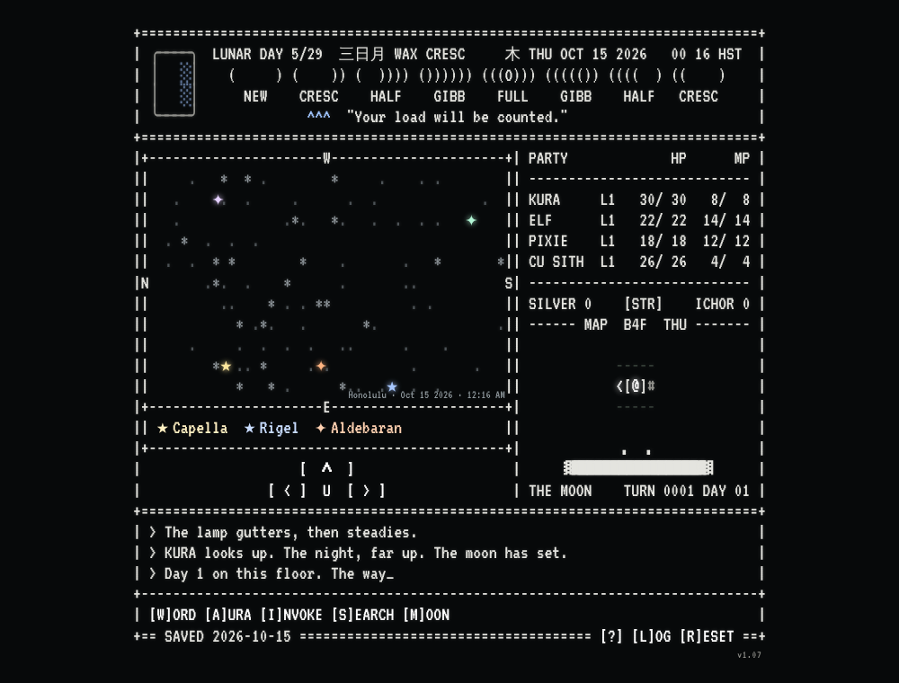

- **Looking up shows the real night sky over you.** The stars are where they really are right now, for where you are, and the moon is where she really is, at her real phase. If she's set or hasn't risen yet, she isn't there.
- **The sky turns.** Stay looking up and it moves with the real night. Turning while looking up turns the sky overhead with you.
- **The brightest stars** shine in their own soft colors, and the ones that are up are named along the bottom. The place and time sit in the corner.
- **Fight text** shows two lines at a time. New lines rise in from the bottom and the older ones roll up, so it's easier to follow.
- **The APPEARS screen** unfolds more slowly, without blank lines between.
- **INVOKE:** ICHOR is always listed, even at 0. An empty bag just says so. Pressing a number uses that thing right away.
- **A party member's line stays on the top line** until something else replaces it, instead of going blank.

## v1.06 - A Word With the Moon - Oct 14 2026, 23:35 HST

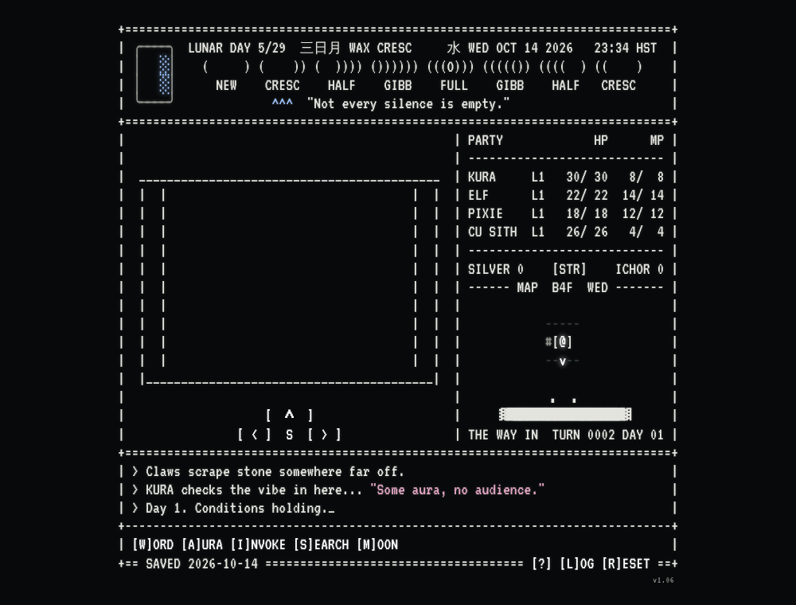

- **`[W]ORD` takes the place of TALK and BEHOLD.** With the party it's a little scene: someone checks in, two who don't get along make peace, someone has something to say, and now and then someone holds out two things and you take one, or asks for one of two things from your bag. A WORD can only help, never hurt. It takes a breath, and the same member has less to say the more you ask in a day. They're fresh again in the morning.
- **Talking no longer wears on anyone's patience.** WORD is how you bring it back up.
- **WORD with a demon** can end with it going its way, sometimes leaving something behind, offering to join, or offering you one of two things. An angry demon won't hear words, but KURA can show it what she carries, and if it sees something it wants, the fight can end there.
- **Offers:** press `[1]` or `[2]`, or `[ESC] LEAVE IT`. With a full bag, taking one becomes a swap: you pick what to give back. A demon won't wait, so leaving its offer asks first.
- **Everyone carries things now.** Every demon and every party member has a few things of their own, and that's what they offer and what they take. Party members go out at night and sometimes come back with something.
- **A beaten demon drops what it was carrying.** No more SILVER from demons, and no moon things from them either.
- **`[A]URA` only reads the world.** Facing a wall, KURA reads the room: how loud she is in it, and how much it's stirring. Facing a door, she gets her hunch. Either costs half a breath now. In a fight, AURA also hints at what a demon is carrying.
- **`[M]OON` is one press.** KURA looks up and asks her in one go, for a breath. SCRY is gone. Some nights she offers you one of two things no one else has, more often the fuller she is. She doesn't ask twice. Ask too many times in one night and she goes quiet.
- **More breath.** KURA has more of it, gets it back sooner, and the wait for pressing on while out is shorter. After she runs out, the countdown follows her next few breaths back.
- **The APPEARS screen and the fight box show three lines at a time,** newest on top, with older lines scrolling down.

## v1.05.3 - True Colors - Oct 14 2026, 20:33 HST

- **An AURA read's color follows KURA's alignment.** It slides from violet on the LAW side to hot pink on the CHAOS side.
- **AURA on the "APPEARS" screen unfolds a line at a time,** like the demon's entrance, instead of all at once.

## v1.05.2 - Reading the Room - Oct 14 2026, 20:26 HST

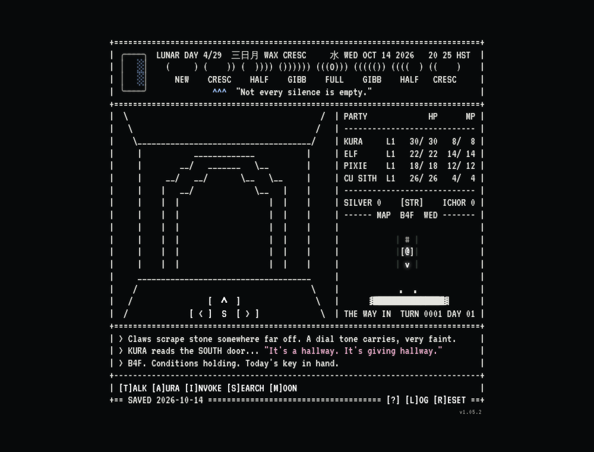

- **AURA plays out like a search.** Line 2 shows what KURA does, three dots, then what came of it, all on the same line and in her own color.
- **AURA can't be double-pressed.** Nothing else works until the read is done, so a quick second press no longer gets lost.

## v1.05.1 - Pack Light - Oct 14 2026, 20:16 HST

- **The bag holds 9 things.** When it's full, a new find asks what to leave behind, or you can leave the new thing where it lay. ICHOR doesn't take a slot.
- **INVOKE is more compact**, with one line per thing and the bag count beside the title. Press 0 for ICHOR.
- **Fiddling with a thing long enough tells you something about it.**
- **AURA before a fight** reads the demon right on the "APPEARS" screen, without starting the fight.
- **AURA outside a fight** shows what KURA does first, and the answer a beat later.
- **KURA is always KURA** in the party panel. Your name is just for the board, and you type it when you post.
- **BEHOLD's list** shows only how loud each thing is.
- **After a fight**, the bottom line waits until you close the end screen.
- **Plain search results are a plainer grey.**

## v1.05 - Aura Farming - Oct 14 2026, 19:42 HST

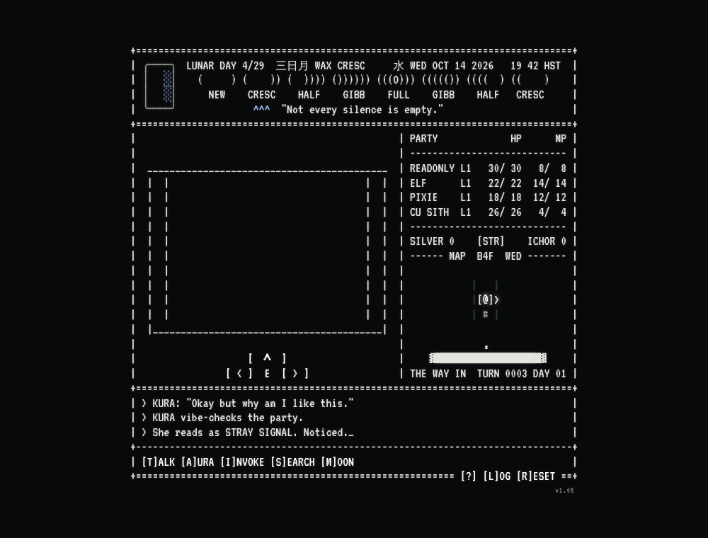

- **`[A]URA` works anywhere now.** Facing a door, KURA reads it and gets a hunch about what's behind it. That takes a breath, and the hunch stays the same if she asks again. Facing anything else, she checks the party's aura and her own: someone reacts, and the bottom line says how she reads.
- **No name to start a run.** Every run begins under a placeholder name. Click the name in the party panel to change it any time, or change it when you post your score.
- **Placeholder names are dimmed on the leaderboard.**
- **Plain search results are light grey** instead of sand.
- **The bottom line holds a finished line for four seconds** instead of five.

## v1.04.4 - Sand and Moonlight - Oct 14 2026, 19:10 HST

- **Plain search results are warm sand** instead of grey, so an ordinary find reads easier.
- **All the flavor is on the top line.** The moon's chatter, her reactions after a fight, the dungeon noticing KURA, and the line after a good find are on line 1 now. The bottom line is status only.
- **The "Ow..." lines are gone.**

## v1.04.3 - Don't Mind Me - Oct 14 2026, 19:02 HST

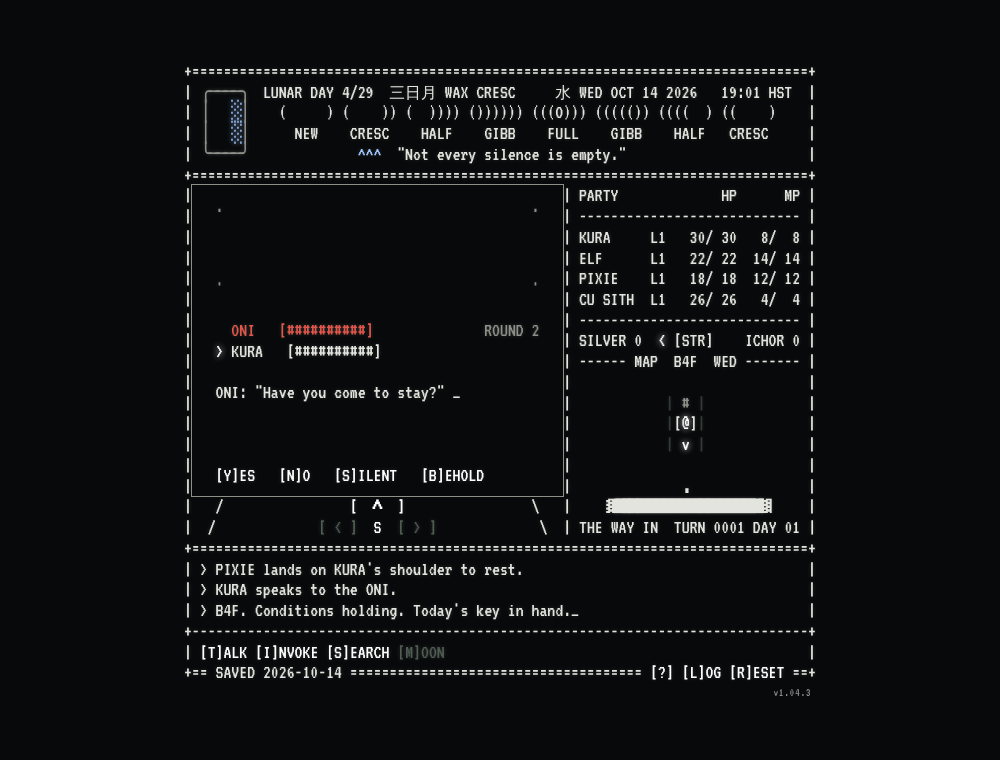

- **Searching no longer wipes the bottom line.** Whatever it's saying finishes as usual; the next line waits until the search is done.

## v1.04.2 - A Moment's Peace - Oct 14 2026, 18:55 HST

- **The bottom line is more patient.** It waits a few seconds after KURA does something before it starts a new line, and after a search it waits until the result has finished.

## v1.04.1 - Show, Don't Tell - Oct 14 2026, 18:50 HST

- **One item move: `[B]EHOLD`.** KURA holds something up and keeps it. If the demon wants it, it asks, and `[Y]ES` hands it over. That's how a gift or a peace offering happens now. `[G]IVE` and `[P]EACE` are gone from fights.
- **One row of buttons.** A demon's question gets `[Y]ES [N]O [S]ILENT [B]EHOLD`. An angry demon gets `[F]IGHT [A]URA [R]UN [B]EHOLD`, so you can always hit back.
- **AURA from the start.** The screen where a demon appears has the fight buttons on it, so you can read it before anything else.
- **AURA once a round.**
- **AURA lines name the demon,** so it's clear who's who.
- **The fight box shows three lines,** so you see what KURA did, what the demon said, and the hit.
- **The bottom line goes quiet in a fight.** It only speaks up when KURA gets hurt.
- **The dungeon notices** when KURA's aura gets louder or quieter, on the bottom line.
- **The moon talks to herself** on the bottom line now and then, and has opinions about fights.
- **A crowded new-demon screen** no longer pushes its buttons out of the box.

## v1.04 - Read the Room - Oct 14 2026, 18:30 HST

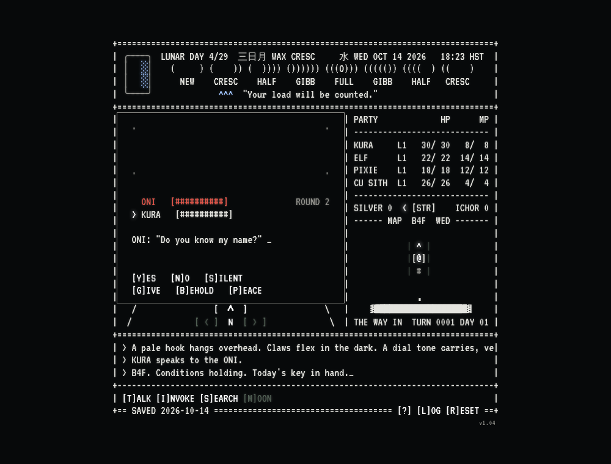

- **Aura.** Everything has one now: every demon, every thing in the bag, and KURA. Machine things read as SIGNAL, HUM or STATIC; old and living things as KEPT, STRAY or FERAL; things that are both get one of each. The codex says what each one means.
- **`[A]URA` in a fight.** KURA sizes the demon up: what it reads as, how loud it is, and what it might like. It's free. KURA has opinions.
- **Talking got hands.** `[G]IVE` moved into the talk, next to two new moves: `[B]EHOLD` holds something up for the demon to see (KURA keeps it), and `[P]EACE` offers something to calm it down. The wrong thing can make it worse.
- **An angry demon can still be reached.** It won't hear words anymore, but TALK lets KURA show it something. It keeps swinging while she tries.
- **KURA can be loud.** What she carries adds to her aura, and the bag shows how loud she is. A loud aura gets noticed: by demons, by the dungeon, and by the moon.
- **KURA's tag** next to SILVER is now KPT, STR or FRL.
- **The moon has moods.** She's solemn when she's dim and has more to say when she's full.
- **The exchange is closed for now.** Its screens are gone from the dead ends, and things found stay in the bag. Nothing kept with it is lost.
- **Hold Omen** is gone from the bag for now.

## v1.03 - A Name Over the Gate - Oct 13 2026, 20:31 HST

- **New lettering on the title.** The name over the pit is drawn in a new hand now, slanted, across two lines.
- **The crescent grew to match**, and sits level with the name.

## v1.02 - Hold Your Breath - Oct 11 2026, 17:37 HST

- **Searching has weight.** What KURA turns up is typed out a letter at a time, with a beat between sentences. When something good is coming, the wait runs a little longer.
- **The party leans in** when a search is about to turn up something good.
- **The pit answers.** The bottom line goes quiet while KURA searches, and after a good find, it has something to say.
- **The find box is for good finds now.** Lesser things go straight into the bag.
- **The dots over the breath bar** count the other way: one when she's rested, more as she tires.
- **The exchange screen's arrow** moves a little quicker.

## v1.01 - The House Rolls - Oct 11 2026, 17:15 HST

- **The exchange decides what a find is worth trading.** When KURA turns up something rare, the exchange rolls its own dice for exactly which thing it is, and the box waits a moment to show you. Fewer finds a day count for trading, and moon things fewer still.
- **The exchange window says when offers close:** at the end of the quarter, with the days left.
- **Exchange rooms have their own names now.**
- **The stash** just says special things go there.
- **The screen's arrow** follows the market's trend instead of every flicker.
- **The breath bar** is one bright bar with a dark square at each end, closing in from both sides, and sits in the middle of its panel.

## v1.00.1 - Where the Moon Things Go - Oct 11 2026, 16:55 HST

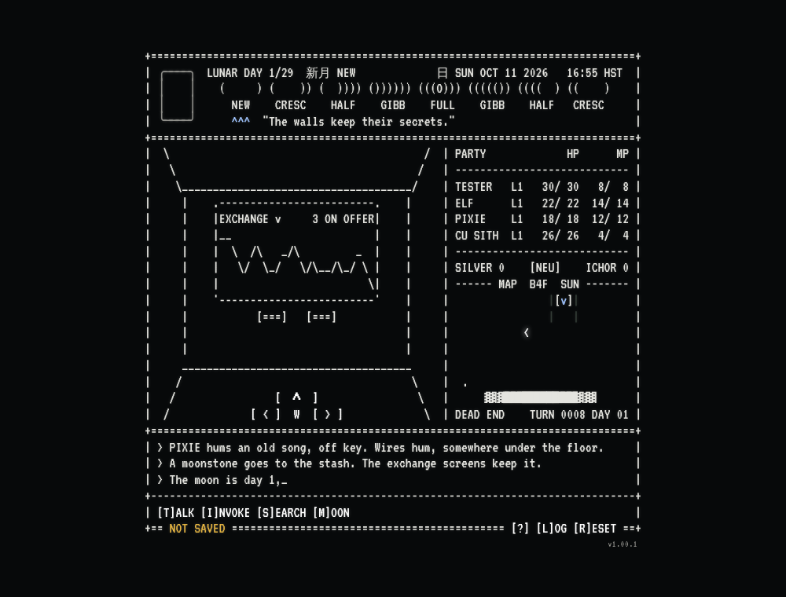

- **A moon thing kept for later now says where it waits:** with the exchange screens, not behind a button that's gone.

## v1.00 - 100 - Oct 11 2026, 16:42 HST

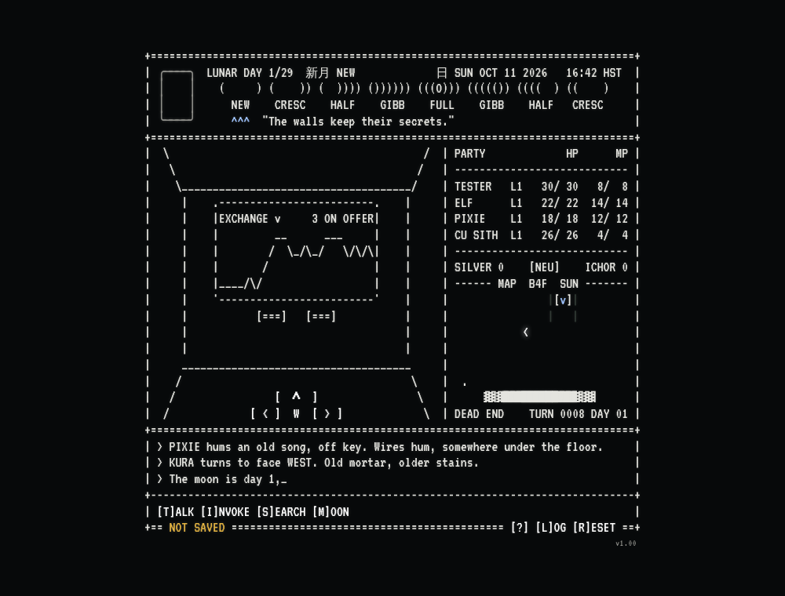

- **You can tell when someone else is in the pit.** The title counts who is down there right now, and on which level. In a run, the bottom line will tell you when others are on your level with you. Only how many, never who.
- **The exchange.** At the end of every wing there is now a screen in the wall, its market line climbing and falling. Touch it to trade with other players: rare things, old relics, and what the moon leaves behind. Make an offer for nothing, or ask for something back. Share an offer by its code, or put it up for anyone. Every offer closes when the moon turns.
- **Moon things keep.** Found in the right light, they wait for you between runs.
- **Your password carries your key now.** Whoever holds it holds what you keep. Keep it to yourself.
- **The market shows in the rumors** on the title.

## v0.99.4 - One Line for the Moon - Oct 11 2026, 13:45 HST

- **The title's heading is back to one line** ("2nd QTR - 上弦 WAX HALF - Lunar Days 9-15"). The floor line is gone, since the LEVEL line below the frame already gives it.

## v0.99.3 - Room Below the Moon - Oct 11 2026, 13:40 HST

- **The title's heading has a blank row under it,** so it no longer sits against the line below. To make room, the branches under the line of days are now one row deep.

## v0.99.2 - Two Lines for the Moon - Oct 11 2026, 13:35 HST

- **The title's heading is two lines:** the floor (B3F), then the quarter, the moon in Japanese and English, and the lunar days ("2nd QTR - 上弦 WAX HALF - Lunar Days 9-15"). It sits in the same place every day.

## v0.99.1 - The Twenty-Sixth Night - Oct 11 2026, 13:10 HST

- **The waning crescent's Japanese name is now 二十六夜,** the traditional "twenty-sixth night," in place of a word that isn't in the dictionary.

## v0.99 - Moon in Kanji - Oct 11 2026, 13:00 HST

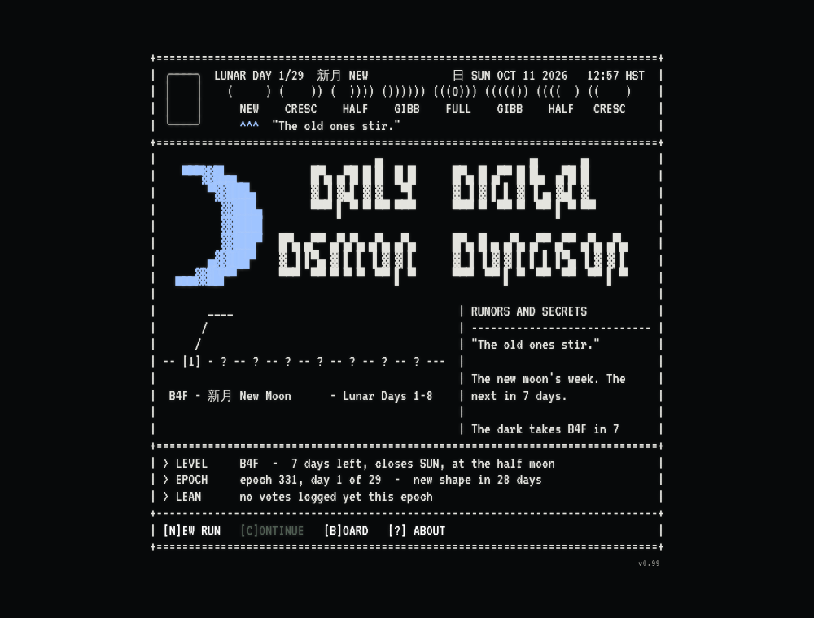

- **The header counts the lunar day** ("LUNAR DAY 10/29"), the same day the title screen counts.
- **Today's phase in Japanese** sits beside its English name in the header.
- **The title's heading names its quarter in Japanese,** and "Lunar Days" now sits in the same place for every quarter.
- **The kanji are a little smaller.**

## v0.98 - Short of Breath - Oct 11 2026, 12:40 HST

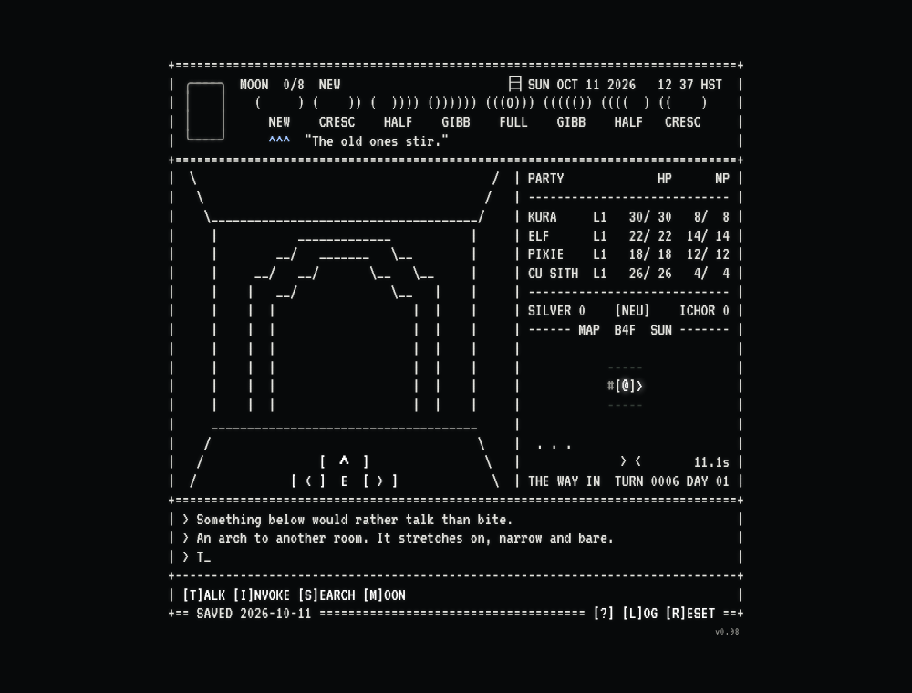

- **Out of breath, pressing on makes the wait longer.** Each try adds a little to the countdown, up to a limit. A held key counts once.
- **The dots above the breath bar count it too:** one when she is rested, three when she is out.
- **A search reads "KURA searches the wall..."** and the result follows on the same line.
- **The arrows on the breath bar** are no longer covered by it.

## v0.97 - Plain Words - Oct 11 2026, 11:59 HST

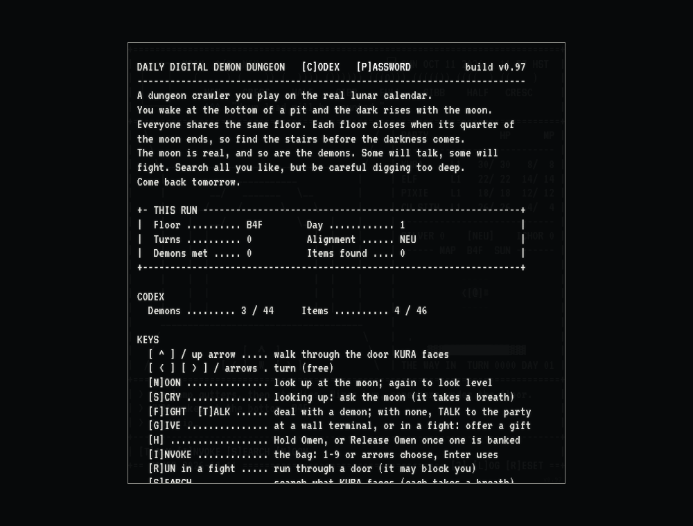

- **The `[?]` page opens with a new, plainer intro.** It says what the game is and leaves the rest to find out.
- **THIS RUN has a border** around it, so it stands out.

## v0.96 - Crescent Over the Gate - Oct 11 2026, 11:40 HST

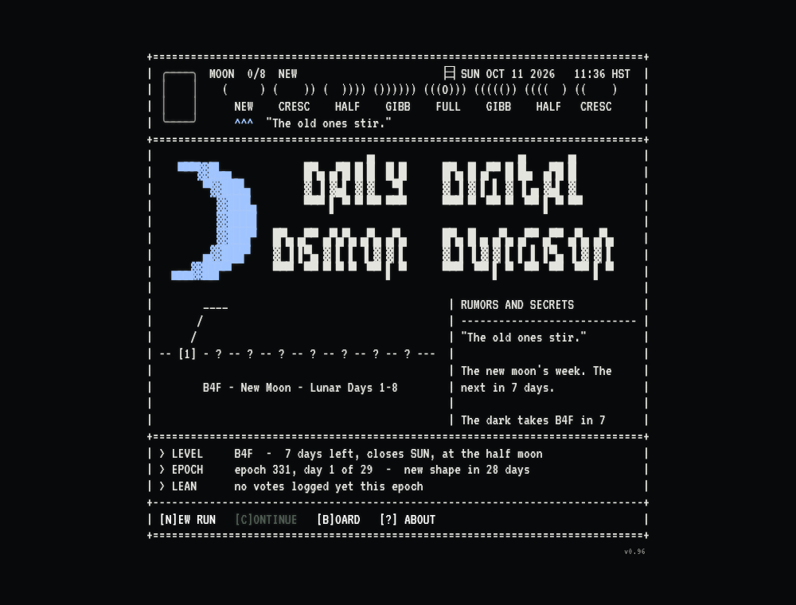

- **A crescent moon on the title screen,** to the left of the lettering. It is the same every day.

## v0.95 - The Locked Drawer - Oct 11 2026, 10:51 HST

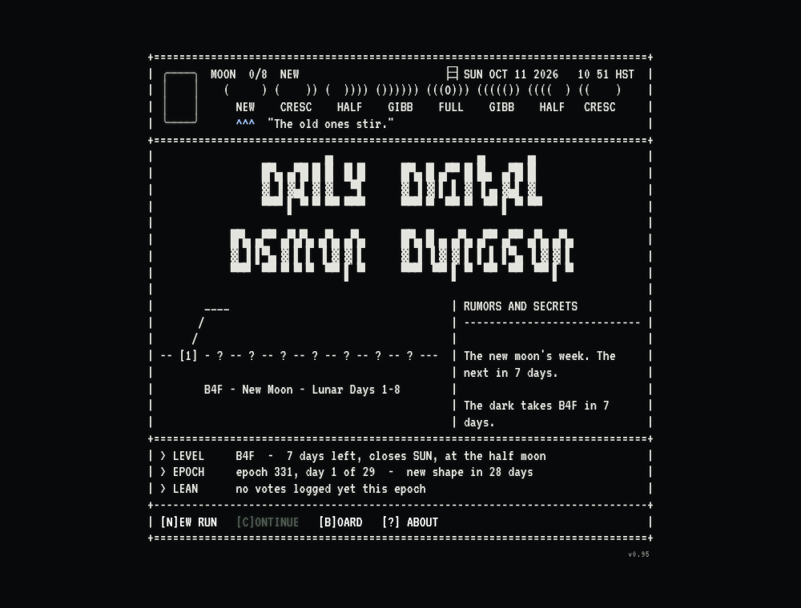

- **The developer's testing tools are behind a password now.** The hidden keys do nothing until it is given.
- **A run that used one can't post a score,** and its last page says so.

## v0.94 - The Name in Lights - Oct 11 2026, 09:15 HST

- **A new title.** The game's name in block letters, across the whole screen.
- **Under it,** the level's line of days on the left and the rumors on the right. The line's heading names the level, the moon and the lunar days: `B4F - New Moon - Lunar Days 1-8`.

## v0.93 - The Line of Days - Oct 11 2026, 08:57 HST

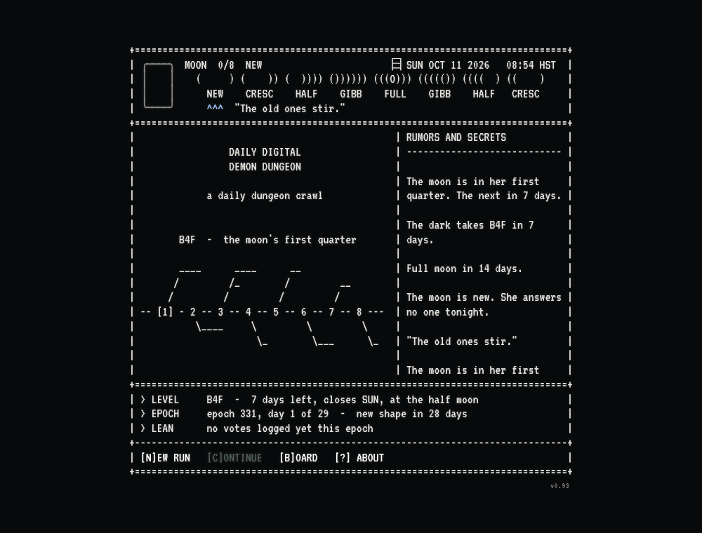

- **The title screen draws the level.** A line of this quarter's days with a branch off each, the same for everyone. Days that haven't come yet are hidden; it fills in as the quarter goes.
- **A search always takes its beat,** even when a demon or a find comes of it.
- **`[F]IGHT` left the bottom bar.** It is in the fight box, where it is used.
- **The typed line** ends its sentences properly and holds each one a little longer.

## v0.92 - In Color - Oct 11 2026, 08:38 HST

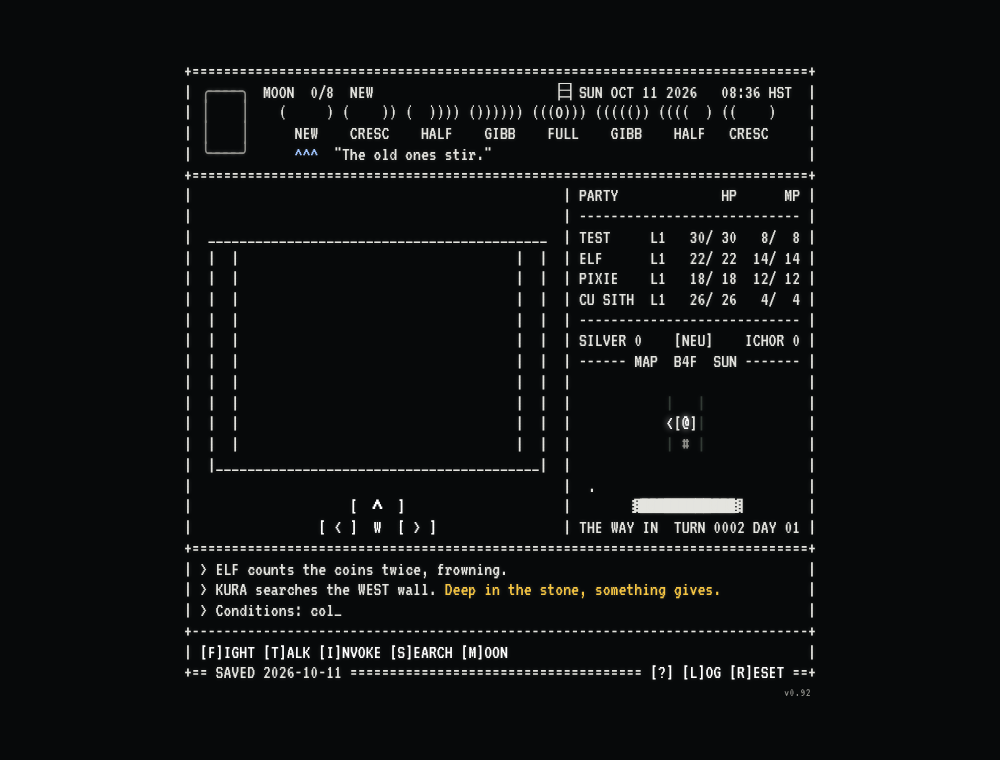

- **What a search turns up is colored by what it is:** grey for nothing much, silver for SILVER, blue for something rare, gold for the best of it, lavender for the moon's own.
- **A search plays out on its own line:** three dots, then the result, a sentence at a time. No box to dismiss; the box for an actual find stays.
- **Found money is SILVER,** and says so.
- **The typed line** is a little quicker, and waits a moment between lines.

## v0.91.1 - A Slow Hand - Oct 11 2026, 08:16 HST

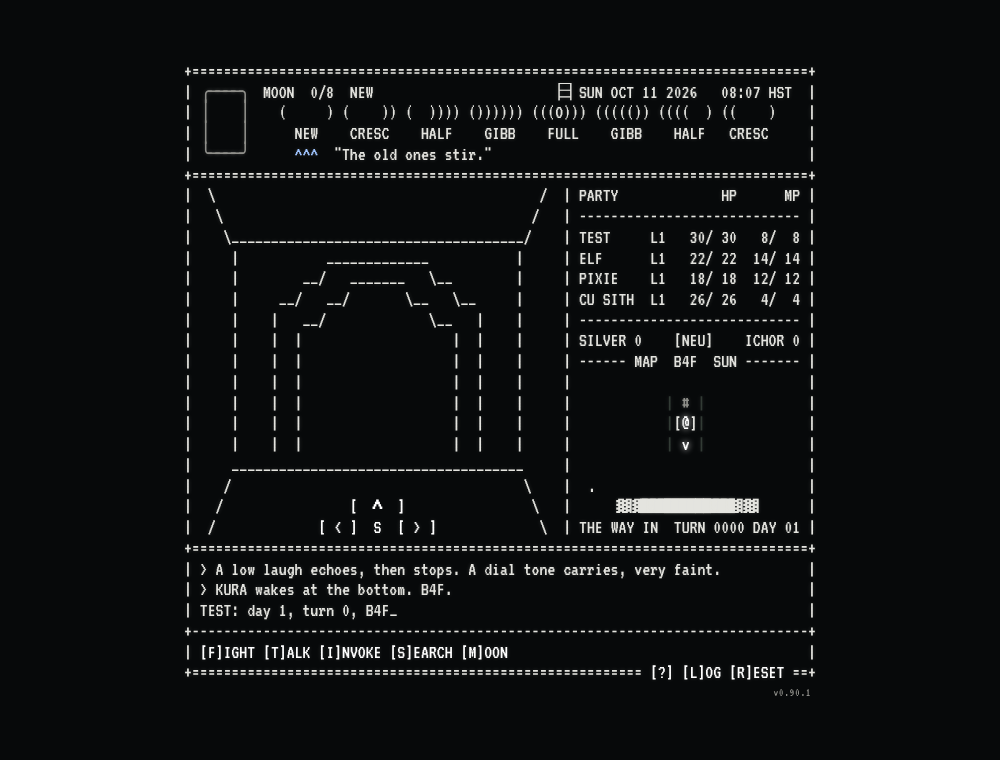

- **What a search turns up gets its own line,** above the line that says KURA searched. A find shows in gold.
- **The typed line is slower,** both the typing and the deleting, and starts with a `>`.
- **It has more to say about your run:** the party, the demons, the walls, the doors, and less that the screen already shows. Two lines about you, then one about everyone else.

## v0.91 - Typed - Oct 11 2026, 08:08 HST

- **The bottom line of the log is typed now,** not scrolled: a line appears a letter at a time, stays a moment, is deleted, and the next is typed.
- **A search has a beat again.** The log says what KURA is doing, with a blinking `_`, and then the result opens.
- **`[M]OON` stays where it is** when `[S]EARCH` becomes `[S]CRY`.

## v0.90 - News From This Level - Oct 11 2026, 07:58 HST

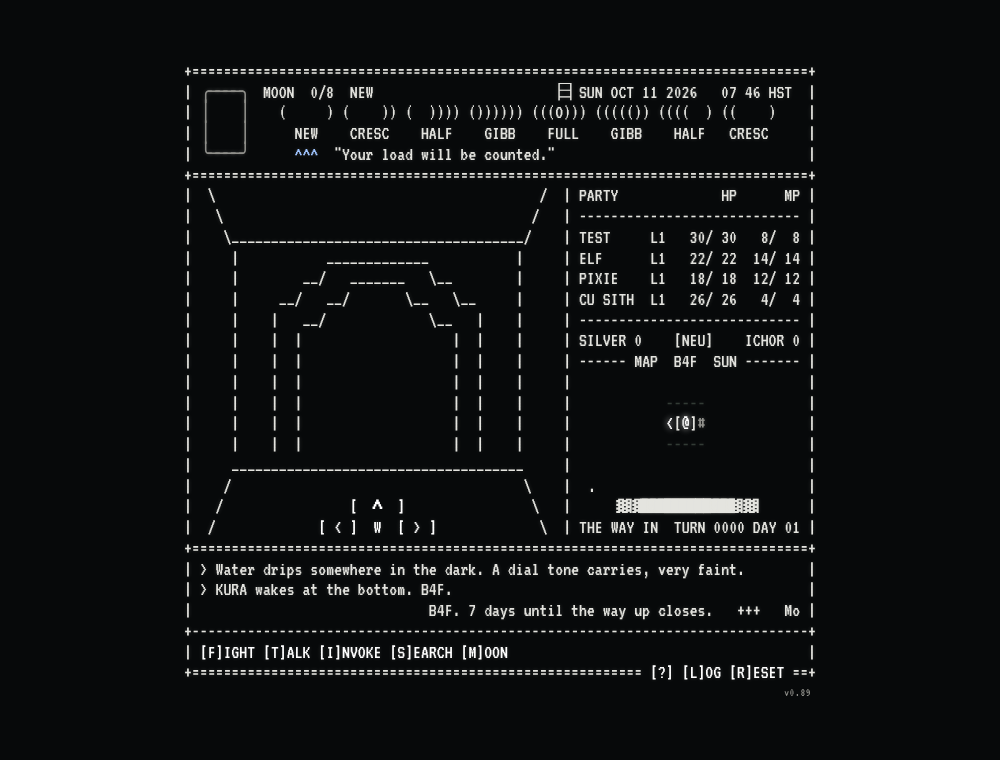

- **The ticker is about people now.** It carries news of your own run and of other players, and leaves the month's totals to the title screen.
- **It says where things happened.** News from your own level comes first: "On this level, day 2: ..."
- **It moves a little slower.**

## v0.89 - The Ticker - Oct 11 2026, 07:50 HST

- **A ticker runs along the bottom of the log,** right to left: how your own run stands, and word from everyone else.
- **The flavor line moved to the top,** where the quotes are. What you just did stays in the middle.
- **Searches are instant again.** The "searching . . ." wait is gone.

## v0.88.1 - Plain Boxes - Oct 11 2026, 07:39 HST

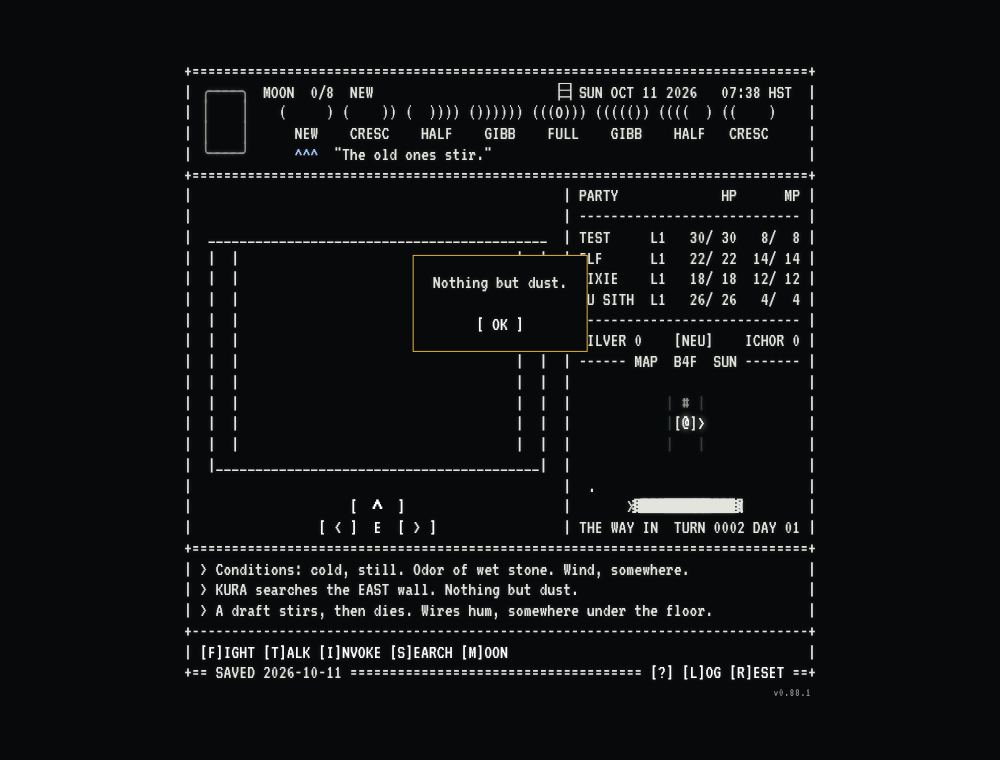

- **The search box says only what was found,** not that KURA searched.
- **No glow around any box.** The gold border stays.
- **The countdown shows only when you are out of breath,** and counts down to when you can act again.

## v0.88 - Half a Breath - Oct 11 2026, 07:34 HST

- **A step takes half a breath** now, not a whole one.
- **A countdown beside the breath bar** shows the seconds until the next breath is back.
- **Search results come up in a small box** with `[ OK ]`, in place of the blinking `_` on the log.
- **The bar is pressed** (`>` `<`) for every breath spent, whatever spent it.

## v0.87 - Scry - Oct 11 2026, 07:27 HST

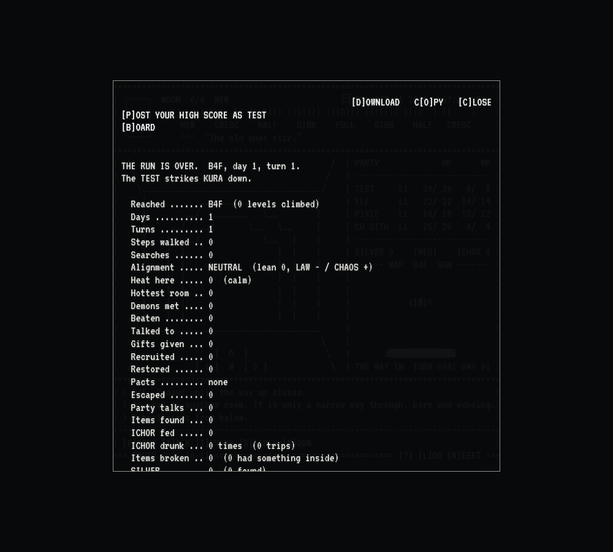

- **`[M]OON`** on the bar looks up at her, and again to look level. While you look up, `[S]EARCH` becomes `[S]CRY`.
- **Breath goes further now.** Every step into another room takes one, and so does using something from the bag. Fighting never does.
- **Every search takes its moment,** doors and archways included, and every result waits with the blinking `_`.
- **The breath bar sits in the middle** of its panel.
- **When a run ends,** the last page shows the level laid out day by day: how much of each day's rooms you saw, and the room you took. The doors you left shut stay unknown.

## v0.86 - Wait For It - Oct 11 2026, 07:03 HST

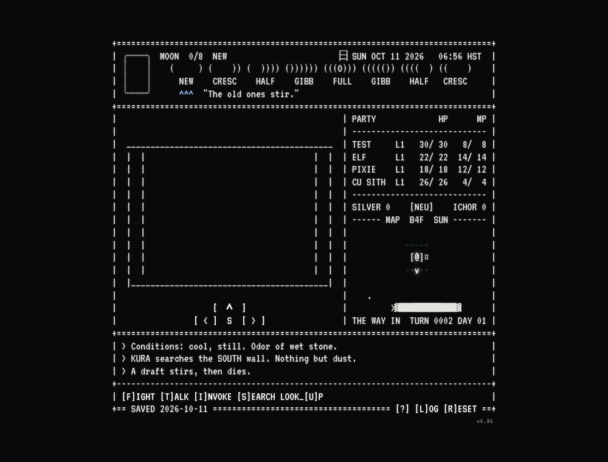

- **A search result waits for you.** It stays on the log with a blinking `_` until you click or press a key. So does being out of breath.
- **The breath bar gets pressed.** A `>` and a `<` close on it for a second each time a search takes a breath.

## v0.85 - Word From Elsewhere - Oct 11 2026, 06:47 HST

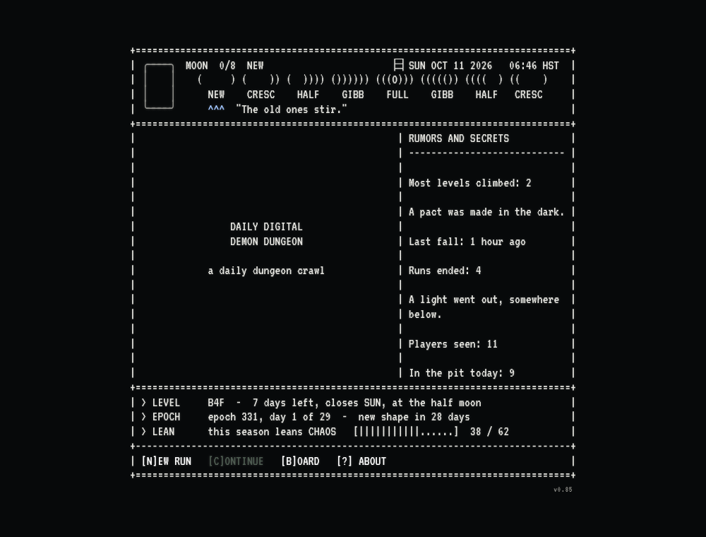

The title screen knows more, and some of it follows you in.

- **Who is here.** The title now counts the players actually in the pit, this moon and today, and how many are on each level. Finished runs are counted separately, as names carved on the board.
- **More numbers:** demons beaten, spoken to and joined; doors unlocked; nights on STANDBY; levels climbed; how often the moon was asked and how often she answered; times someone ran out of breath; SILVER and rare finds; and which demon has ended the most runs.
- **More of the moon:** which quarter she is in and when the next comes, when the dark takes the current level, and how long until she is full.
- **Word from elsewhere.** Now and then the top line of the log carries one of these, marked "Elsewhere".

## v0.84 - Searching . . . - Oct 11 2026, 06:18 HST

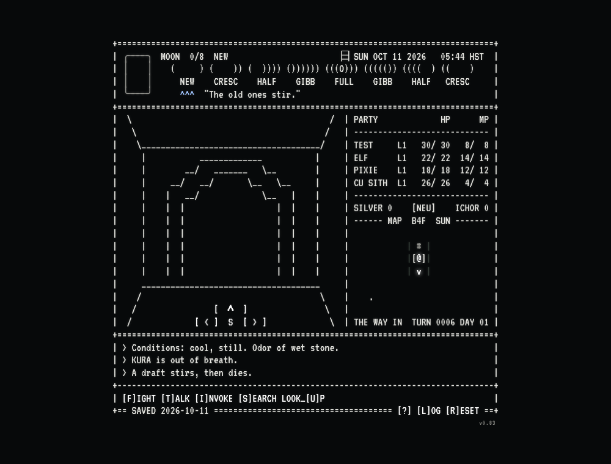

- **A search takes a moment.** The log reads "KURA is searching", a dot at a time, and then what she found. Listening at a locked door does the same.
- **Tired searches are slower.** The lower her breath, the longer that moment lasts.
- Fixed a log line that could come out as "undefined" when looking through an open arch twice.

## v0.83 - Breath - Oct 11 2026, 05:46 HST

KURA gets tired now, and the moon shows it.

- **Searching takes breath.** A handful of quick searches and she is out of it, and has to wait.
- **The moon strip under the map is her breath.** It closes as she tires and opens again by itself. The emptier it got, the slower it comes back.
- **It is hers, not the room's.** Walking somewhere else doesn't bring it back any sooner.
- **Asking the moon takes a breath too,** and nothing else.
- Searches are instant again: the slow searching in worn rooms is gone, and rooms settle overnight as they used to.

## v0.82 - The Key - Oct 11 2026, 05:34 HST

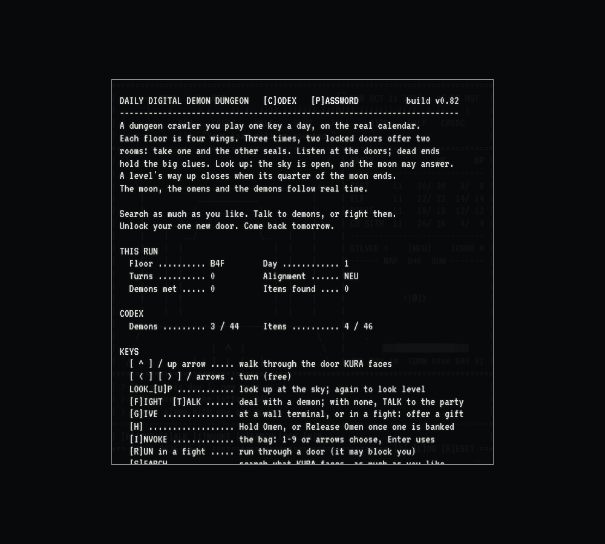

Old words back, and some tidying.

- **The day's key.** What opens your one new door each day is a key again, and doors unlock.
- **The moon strip closes evenly** from both sides.
- **A slow search says so.** In a worn room the log reads "KURA searches..." while she is at it. The screen no longer dims.
- **The [?] page is tidier:** one line a key, everything lined up, and the map's marks in their own list.

## v0.81 - The Moon Closes - Oct 11 2026, 05:24 HST

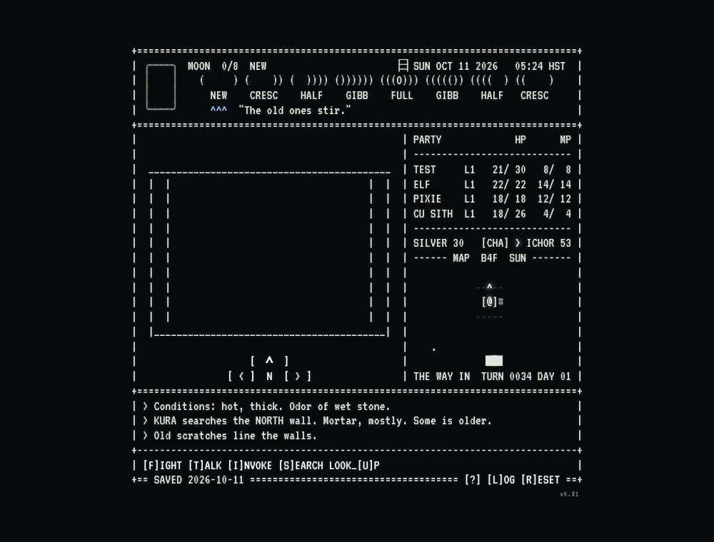

Searching wears a room out, and now you can see it.

- **The moon strip under the map closes** as you search a room, from both ends inward. Wide open is a fresh room.
- **A worn room is slow.** The more it has closed, the longer each search takes.
- **Time opens it again.** A room recovers by itself in real time, whether or not the game is open. Walking to another room does not hurry it.
- **Asking the moon is no longer free.** It wears on the room a little.
- The end screen counts levels climbed.

## v0.80 - Back to the Wings - Oct 11 2026, 05:06 HST

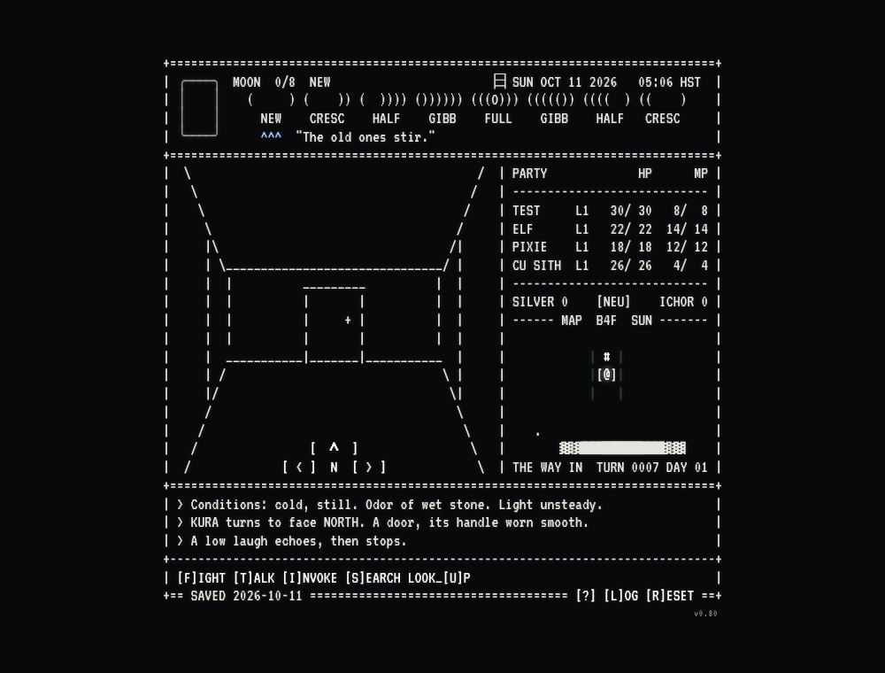

The one-room experiment is over. The wide floors are back, under the open sky. Runs in progress end with this release.

- **Wings again.** Each level is rooms to walk between, with two locked doors a day to choose from, as before. `[ ^ ]` walks forward.
- **The room map is back,** and the compass with it.
- **Still a climb.** You wake in the pit, the stairs lead up, and the dark takes a level each quarter of the moon.
- **Still the sky.** `LOOK_[U]P` shows it from any room, and the moon can still be asked. There is no floor to look at any more.
- **Old rooms return.** Some rare ones that had gone missing can turn up again.
- Gone with the one-room version: the two doors on one wall, the action words on the button, and THE PATH in the log.

## v0.78 - A Word on the Button - Oct 11 2026, 04:52 HST

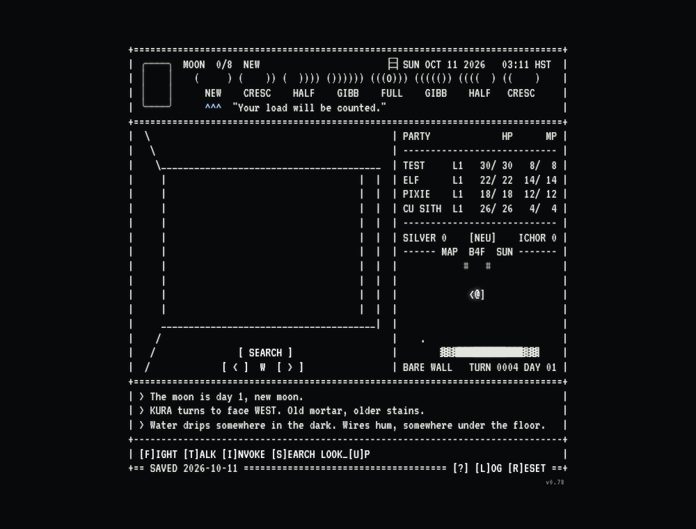

Small changes to how the room is worked.

- **The action button says what it does.** `[ SEARCH ]`, `[ LISTEN ]`, `[ CONSULT ]`, in place of `[ ^ ]` with a word above it.
- **An opened door is labelled `[ ENTER ]`,** right under it. The action button is a plain `[ ^ ]` while it is.
- **A demon's arrival unfolds a line at a time,** like a fight's ending, a little quicker. It can't be skipped.

## v0.77 - Out of the Pit - Oct 11 2026, 03:03 HST

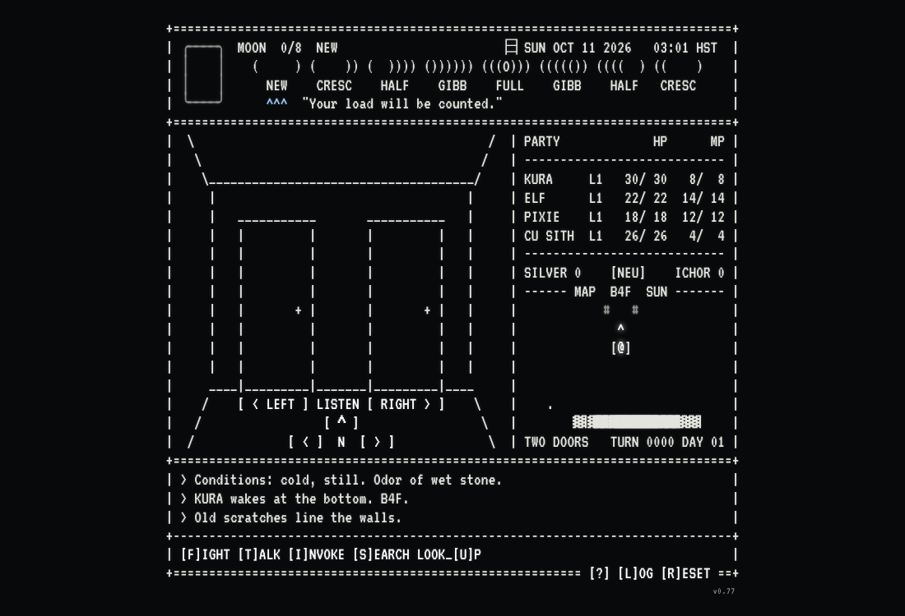

The way is up now.

- **You wake in a pit, and climb.** Four levels down: B4F at the bottom, then B3F, B2F, B1F, then the surface, and on from there.
- **The dark rises with the moon.** It takes a level each quarter of the month: at the half moon, the full, the half, and the new. Be on your way up before then. Sundays no longer matter.
- **Where you wake depends on the moon.** Early in the month, at the bottom. Later, higher up, because the lower levels are already gone. Everyone playing in the same quarter is on the same level.
- **The stairs up are in a wall** of a level's last room. Face them and `[ ^ ]` climbs.
- **The title screen** shows the level the dark has reached, and when it takes it.
- **Saves:** runs in progress start fresh.

## v0.75 - The Path - Oct 11 2026, 02:42 HST

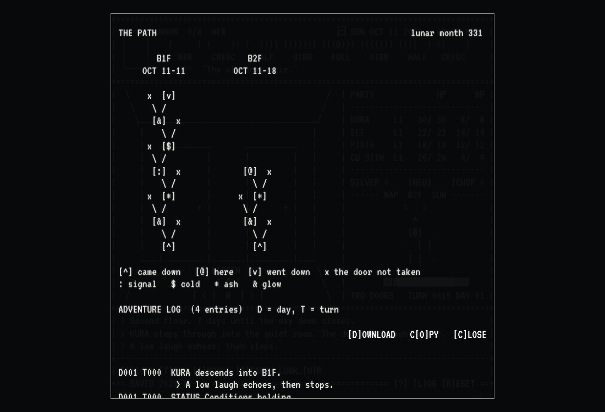

- **THE PATH.** At the top of the log: your whole run drawn as a tree, floor by floor. Every room is a fork, with the door you took going on and the one you didn't ending in an `x`. Each room carries a small mark for what it was like.
- **Tidier controls.** The word for what `[ ^ ]` will do sits just above it. Looking is on the bottom bar now, as `LOOK_[U]P` (then `LOOK_[D]OWN`). The left and right doors are on Q and E.
- **The map** shows the doors ahead on its top row, with KURA in the middle.
- **Dissonance is gentler.** Only a LAW and CHAOS pairing wears on the party now, and only once per fight won. The party you start with gets along.
- **Hold Omen stays in the bag** even when it can't be used; it just goes grey.
- **The end of a fight** can't be clicked through any more. It closes from its `[ OK ]`.

## v0.74 - Whispers - Oct 11 2026, 02:12 HST

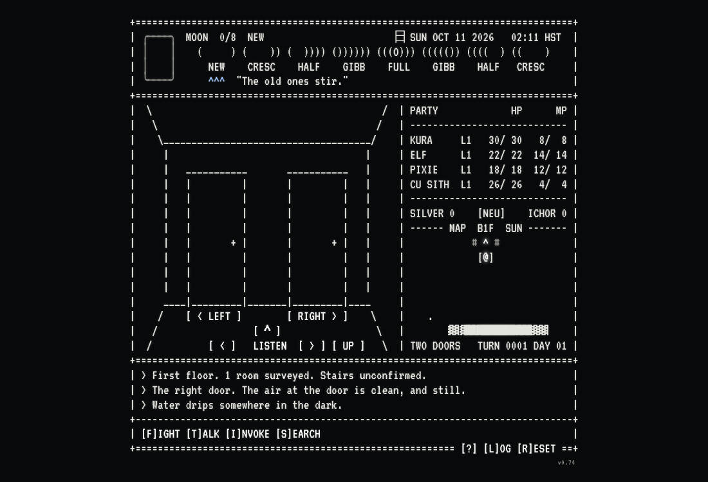

- **Rumors on the title screen.** Mixed in with the numbers now: short, vague lines about things that have happened in other people's runs. No names, no places. Now and then, something's last words.
- **One button for the obvious thing.** `[ ^ ]` (or the up arrow) acts on whatever KURA is facing: search a wall, listen at the doors, consult the moon, step through, go down. The word between `[ < ]` and `[ > ]` says what it will do.
- **Looking has its own button** beside the turn buttons: `[ UP ]`, then `[ DOWN ]`, then `[ AHEAD ]`.
- **The end of a fight unfolds a beat at a time** instead of all at once. A click or Enter shows the rest.
- **The title screen's WEEK line** now says when a new run would start on next week's floor.

## v0.73 - Rumors and Numbers - Oct 11 2026, 01:51 HST

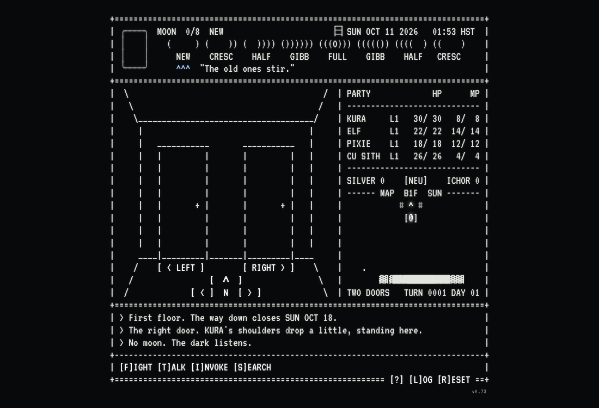

- **The title screen's feed has numbers in it now.** Running totals for this lunar month, from every run posted to the board: the last fall, runs ended, players seen, turns logged, pacts made and ended, items broken, and a few stranger ones. Nobody is named. A number only shows up once there's something to count.
- **The two doors are a little wider.**
- **The map shows which way you're turned**: an arrow ahead, behind, or at KURA's side.

## v0.72 - Left or Right - Oct 11 2026, 01:43 HST

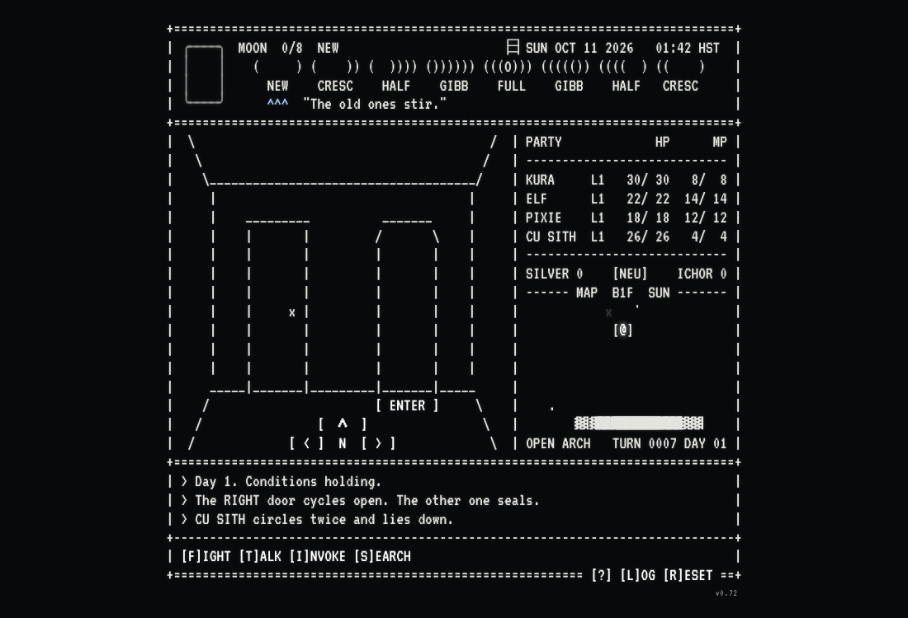

The choice, face on.

- **Two doors, side by side.** The day's two doors now stand together in the wall ahead, with `[ < LEFT ]` and `[ RIGHT > ]` under them (or the A and D keys). Open one and it shows `[ ENTER ]`. Listening at the wall tries each door in turn and says which one you're hearing.
- **Look up: the sky.** There's no ceiling any more, only the night and the real moon at tonight's phase. `[ ^ ]` or the up arrow looks up; again looks down; the down arrow looks straight down. Found stairs show `[ DESCEND ]`.
- **Ask the moon.** Search her, once a night. The fuller she is, the likelier she answers. A new moon says nothing.
- **The line under the map names what you're looking at**: a locked door, a bare wall, the moon. A room's own name is said once, as you step in.
- **The map is your path of choices**: each room a step left or right of the last, with the door you didn't take beside it.
- **Saves:** runs started on v0.70 start fresh.

## v0.70 - One Room - Oct 11 2026, 01:20 HST

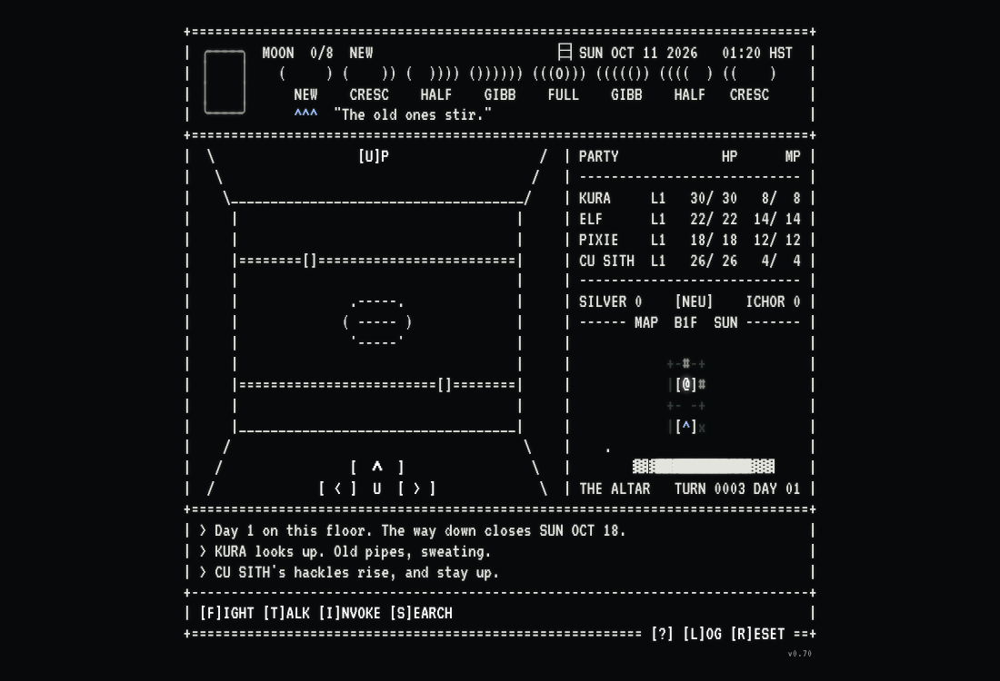

The dungeon is rebuilt around a single room a day.

- **One room a day.** Every room has two locked doors. Open one and the other seals for good; step through and the door shuts behind you. There is no going back.
- **Look up, look down.** The ceiling and the floor can be searched now, along with the walls. `[U]P` (or U) looks up; again looks down; again looks ahead.
- **The way down** is under the floor of the week's last room. Look down at it and go forward.
- **Doors always tell you something.** Listening at a locked door never comes up empty now.
- **The map shows the path you took**, one room at a time: `#` for a locked door, `x` for one sealed for good.
- **Running:** a demon that blocks a run through a locked door no longer costs you the day's charge as well.
- **Gone for now:** the bonus room and THE VOID are resting until they have a place in the new floors.
- **Saves:** this one breaks old saves. Every run in progress starts fresh.

## v0.62.2 - A Shorter Sentence - Oct 11 2026, 00:22 HST

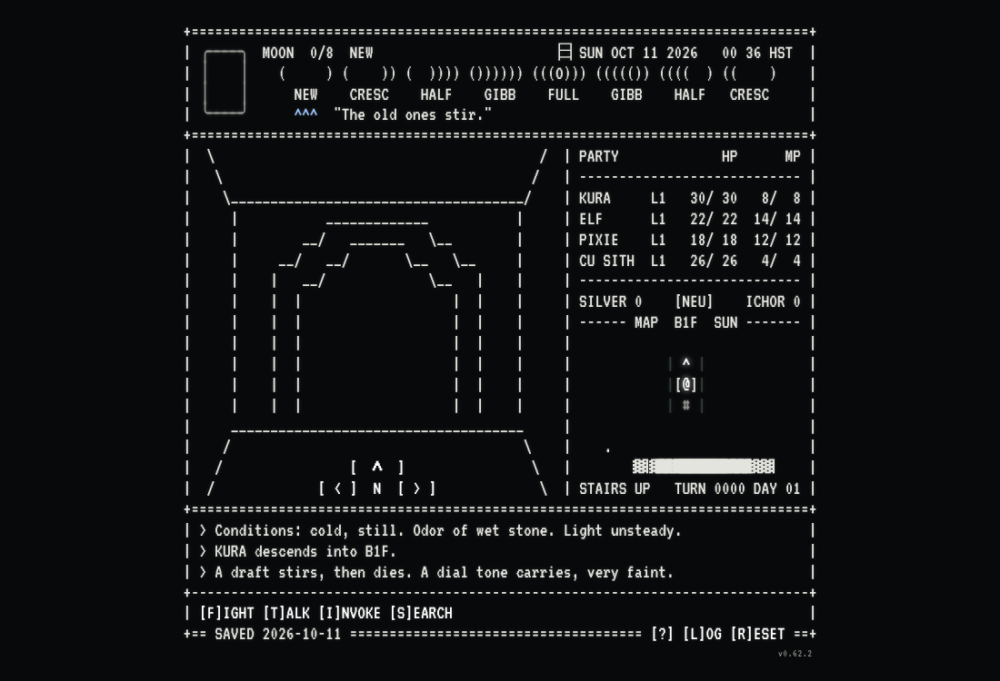

- **One door description ran off the edge of its line** and lost its last few letters. It's shorter now.

## v0.62.1 - Loose Threads - Oct 11 2026, 00:04 HST

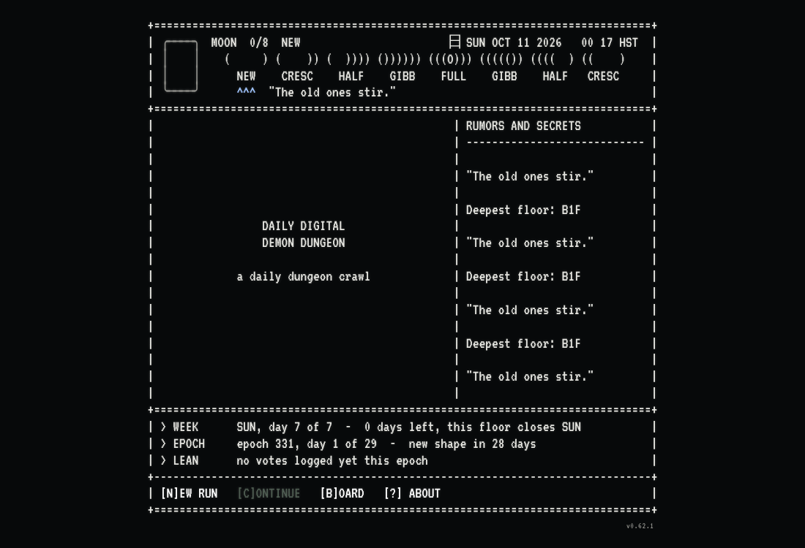

Fixes, mostly to the new title screen.

- **Title screen:** a run in progress no longer flashes over it once a minute, long omens wrap onto a second line instead of being cut off, and the browser's own keys (reload, Tab) work there again. A tied season now reads EVEN in both places.
- **Straight borders.** Some letter pairs were being squeezed into one space, pulling that row's right edge in by a column. Fixed everywhere.
- **Passwords load again.** [P]ASSWORD had been refusing every current run. It's also reachable from the title screen's ABOUT now, so a run can be brought over from another device without starting a new one first.
- **The bag's bottom buttons stay put** when the list is long enough to scroll.
- **Selecting text in the log** no longer closes it.
- **Dissonance:** days spent away now count toward a tense party's wear, not only the last day played.

## v0.62 - The Front Door - Oct 10 2026, 21:48 HST

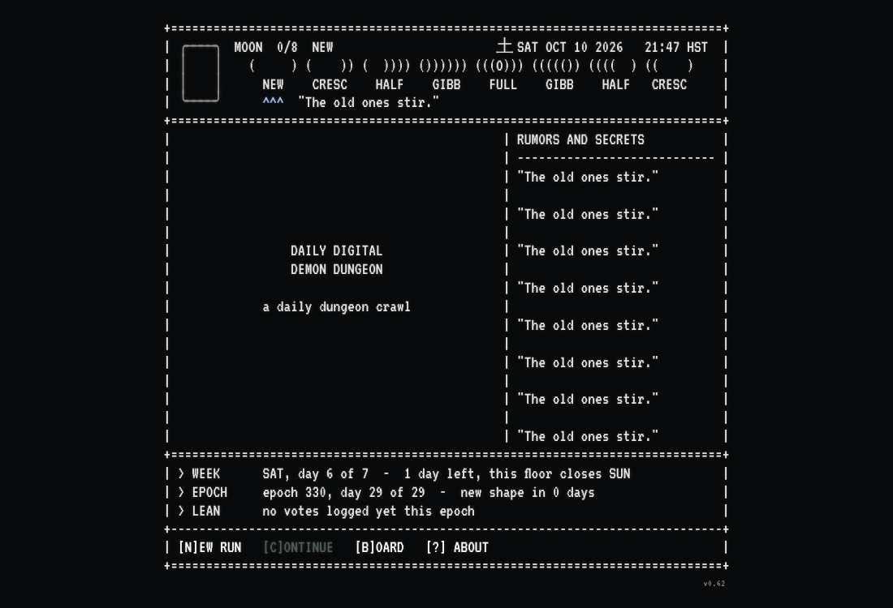

- **Title screen.** The game now opens on a title screen every time, even with a run already in progress — CONTINUE is the explicit way back in. NEW RUN, BOARD, and ABOUT are all here too, and a scrolling sidebar now shows a few running facts (today's omen, the deepest floor reached, which way the season's leaning) while you look.

## v0.61.1 - Bottom Shelf - Oct 10 2026, 21:15 HST

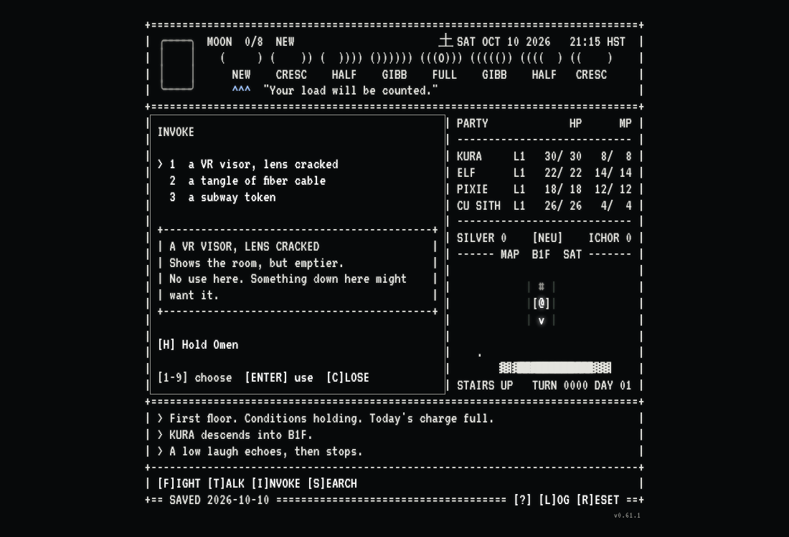

- **Moved the Hold Omen / Release Omen button to the bottom of the bag**, next to [ENTER] use and [C]LOSE, and trimmed its text down to just the button itself.

## v0.61 - A Button of Its Own - Oct 10 2026, 20:30 HST

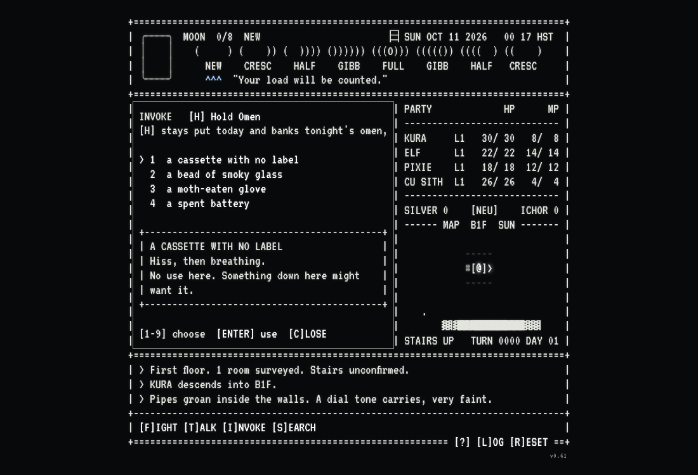

- **Hold Omen has its own button in the bag now.** It used to take up a numbered slot alongside whatever you'd found; now it's a fixed button (and an H key) above the list, so it's always in the same place and never bumps a found item down.
- **The ? help menu's key list is alphabetical now**, easier to scan for a specific key.
- **Every popup (About, Log, Invoke, Codex, the Leaderboard) closes with a click anywhere on it**, not just its [C]LOSE button.

## v0.60 - Taking Sides - Oct 10 2026, 20:09 HST

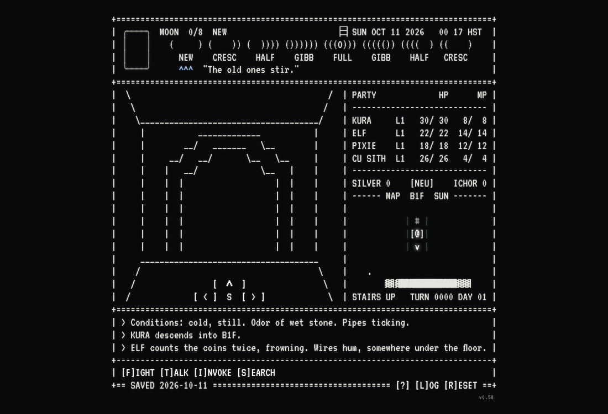

- **Faction seasons.** Every finished run now nudges a month-long, server-side tally toward LAW or CHAOS, deeper runs counting for more. A NEUTRAL run doesn't get its own side — its point goes to whichever of LAW/CHAOS is currently behind, so one side can't run away with a season. Nothing visible in the game yet; this just lays the groundwork the title screen will read from. (The in-game build number wasn't raised for v0.59 or v0.60, so their screenshots still read v0.58.)

## v0.59 - Bad Company - Oct 10 2026, 20:02 HST

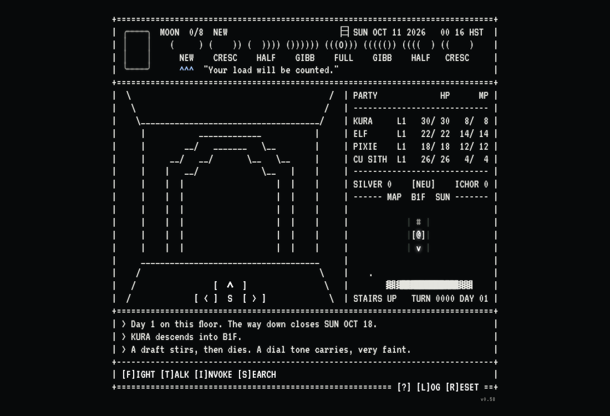

- **Dissonance.** Mixed-alignment parties wear on each other now — fighting, lingering too long in a dangerous room, and skipping a day all chip at a tense member's patience a little faster, worse the bigger the alignment gap between them. No new meter: it's the same patience number as always, just worn down from a second direction, with its own line when a member's at zero over the others rather than over talking.

## v0.58 - One Slot, One Week - Oct 10 2026, 18:55 HST

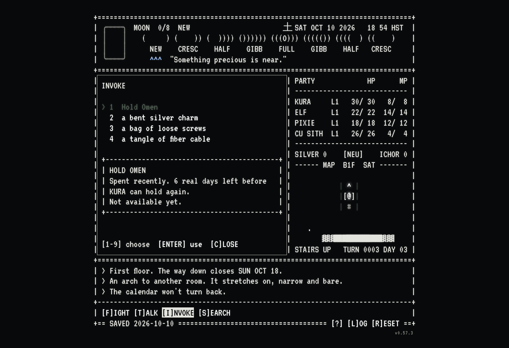

- **Hold Omen and Release Omen are now one slot in the bag.** Releasing a held omen greys the slot out for a week before KURA can hold again.

## v0.57.3 - Into the Bag - Oct 10 2026, 03:25 HST

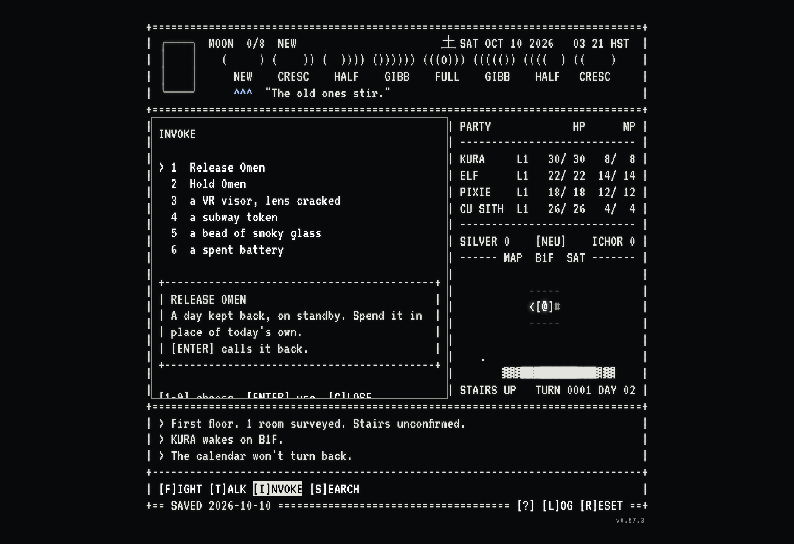

- **HOLD moved into INVOKE, as Hold Omen and Release Omen.** STA[N]DBY is gone from the border — open the bag and pick Hold Omen to go on standby (same confirmation as before), or Release Omen (was THE HELD DAY) once one's banked, to spend it in place of today's own.

## v0.57.2 - No More Cell - Oct 10 2026, 03:20 HST

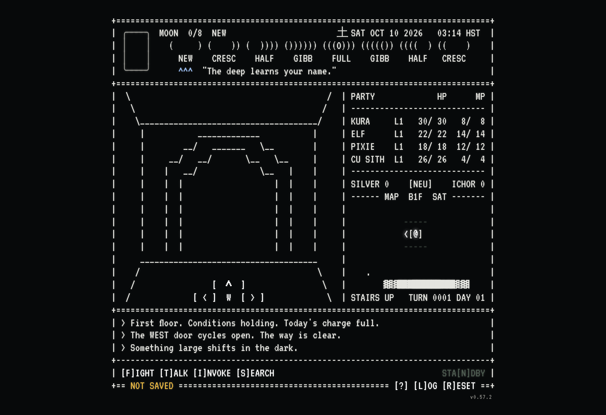

- **CELL is gone from the bottom border.** With the charge system itself gone (v0.57.1), the indicator for it didn't need to stay — the one-locked-door-a-day rule is still there, it's just not called out on screen anymore. STA[N]DBY moves to fill the space.

## v0.57.1 - Simpler Cell - Oct 10 2026, 03:15 HST

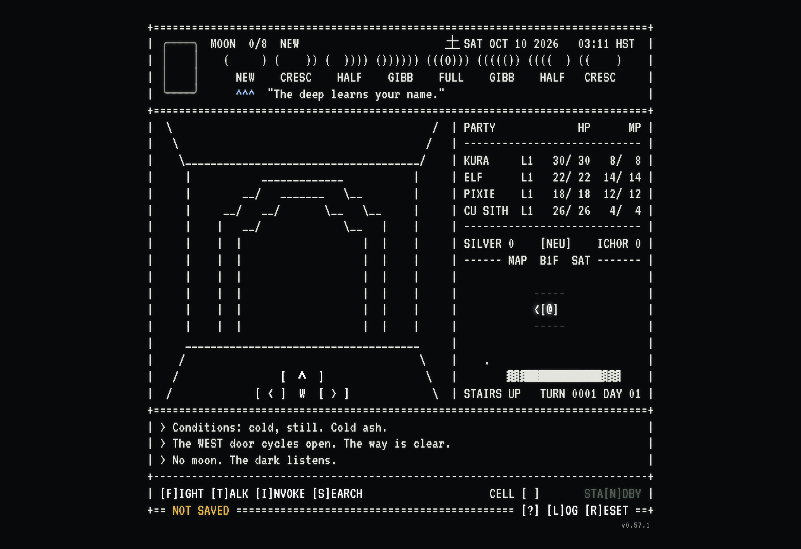

Simpler cell.

- **DISCHARGE is gone.** It wasn't reachable from the UI anyway.
- **The spare-charge catch-up is gone.** Missing a real day no longer banks an extra door-open for later — it's a flat one locked door a day, every day, same as STA[N]DBY.
- **CELL in the bottom border is a single slot now**, not two.

## v0.57 - Your Own Map - Oct 10 2026, 03:00 HST

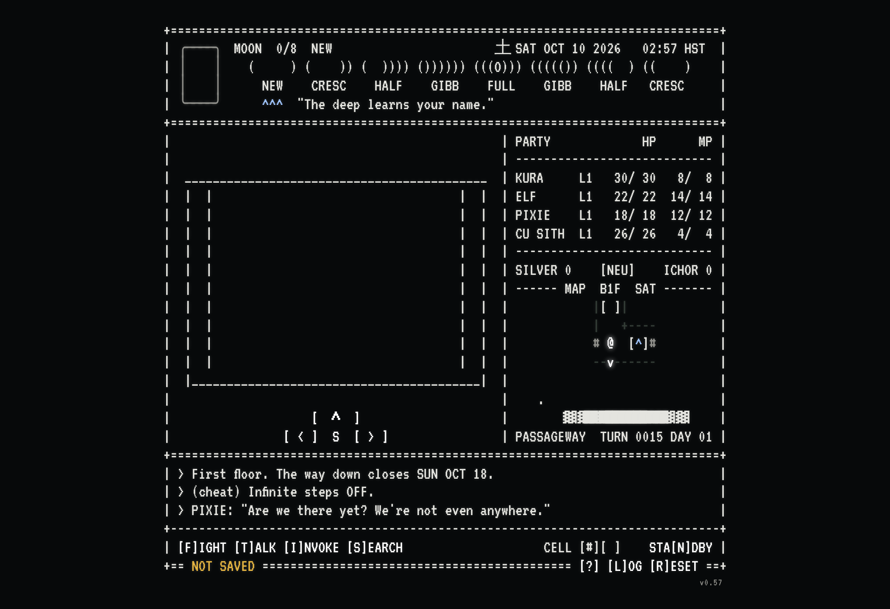

The last gap in shared floors: two players on the same floor now see different maps.

- **Minimaps are private.** The floor's actual shape is still identical for everyone sharing it, but each account sees its own rooms and doors rotated or mirrored, fixed for as long as you're on that floor. 

## v0.56.1 - The Void, Named - Oct 10 2026, 02:00 HST

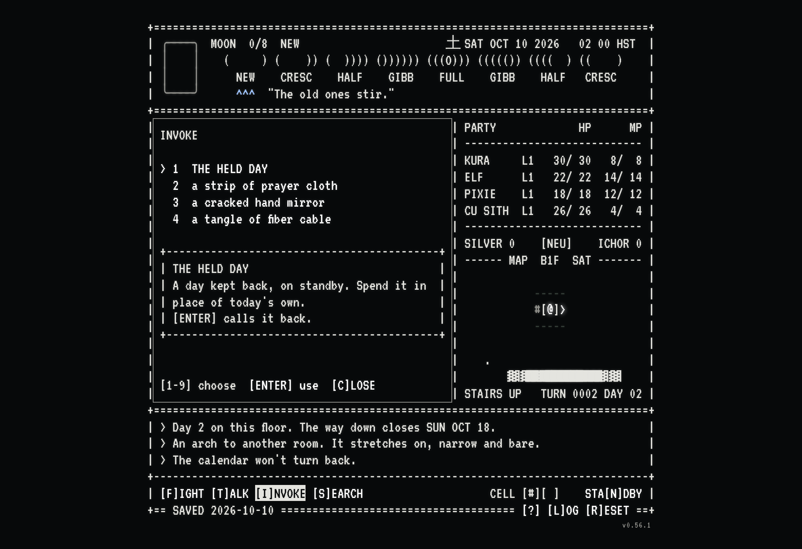

Small fixes to yesterday's release.

- **The held day moved into INVOKE,** as THE HELD DAY — pick it like an item to spend it instead of today's own omen. The `[U]SE DAY` border button is gone.
- **Bonus and anti-bonus rooms are now rolled once a day,** privately, the way they were meant to be — not once per wing unlocked. Roughly the same overall odds, just counted differently.
- **The anti-bonus room is renamed THE VOID.**

## v0.56 - The Same Dungeon - Oct 10 2026, 01:41 HST

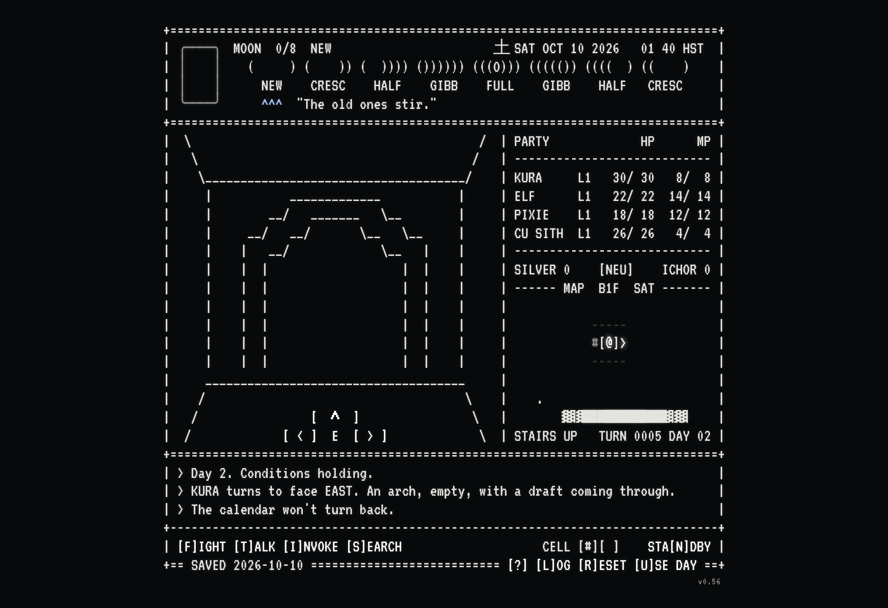

The same floors for everyone, and omens with consequences.

- **Floors:** a floor's shape — its wings, how they connect, which kinds pair up — is now the same for every player this lunar month. What's actually behind each door, and where the day's extra room turns up, stays private to your own run.
- **Omen:** the day's omen is no longer rolled per run. It's the same for everyone, set by the calendar date, and still turns over fresh at your own midnight.
- **STANDBY** now banks that day's omen. Call it back later, in place of today's, with the new [U]SE DAY.
- **Searching:** a near-miss near the one spot actually worth finding doesn't sound like an ordinary one.
- **Arrivals:** stepping onto a new floor says a little more now — who's dominant down here, and whether the pattern feels like it's holding or broken.
- **Saves:** this one breaks old saves. Floors are built differently now, so every run in progress starts fresh.

## v0.55 - Tidier Screens - Oct 8 2026, 04:14 HST

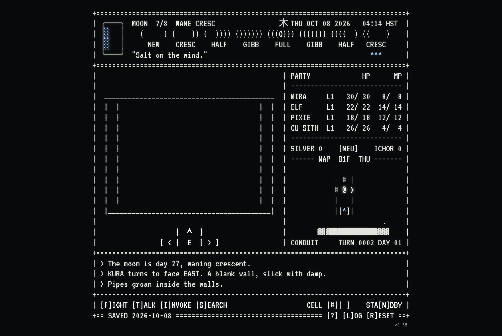

Tidier screens.

- **Popups:** they now close only with their own button or key, never by clicking anywhere.
- **Victory:** just the fallen enemy's last words, then the way is clear.
- **Names:** always shown in capitals; the end screen's post line is easier to read.

## v0.54 - What's Your Name? - Oct 8 2026, 04:01 HST

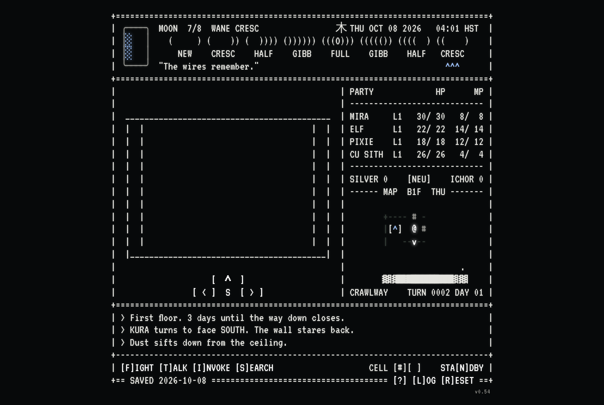

Names, and a terminal with more to say.

- **Name:** each run now begins by asking who you are, and your name heads the party list.
- **Altar:** the terminal talks before it asks, a line at a time.
- **Fights:** the cursor keeps blinking until you choose, and a fallen enemy's last words sit right under the art.
- **Leaderboard:** clearer messages when a score can't be posted, and the end-of-run screen is tidier.

## v0.53 - The Board - Oct 8 2026, 03:30 HST

A leaderboard, and tidier menus.

- **Leaderboard:** when a run ends you can post it under a name and see how it ranks. Open the board from the [?] menu, the bottom border or the B key.
- **Menus:** the bag and the log close with [C]LOSE, and copying the log is now [O].
- **Screen:** clicking no longer highlights the text.
- **Floors:** arriving on a new floor no longer repeats the deadline on the bottom line.

## v0.52 - Kinder Endings - Oct 8 2026, 02:58 HST

Quieter edges and kinder endings.

- **Doors:** the painted ones are gone for now.
- **Party:** a tired member warns you before leaving, and the party has a word about odd walls.
- **Victory screen:** it waits for [ OK ] and can't be skipped by a stray click.
- **Map:** the outline grid is a little brighter, and one room feels stranger to walk into.
- **Run end:** [R]ESET moves to the bottom of the log.

## v0.51 - Last Words - Oct 8 2026, 02:34 HST

Fights wait for you, and the dead have things to say.

- **Fights:** the text now waits for a click or Enter between lines, with a blinking cursor. The enemy's line comes first.
- **Last words:** fallen enemies get a parting remark on the end-of-fight screen.
- **ICHOR:** you now choose who in the party gets it.
- **CU SITH:** says nothing, as before, and now means it everywhere.

## v0.50 - The Party Talks Back - Oct 8 2026, 01:31 HST

Rooms that want something from you, and a party that talks back.

- **Rooms:** Each room has something in it to find and use.
- **Party:** every time you walk into a room, someone in the party has something to say about it.
- **Minimap:** a locked door you are facing shows up white.
- **Looking around:** an open doorway is described as an opening, not a shut door. The turn buttons read `[ < ]` and `[ > ]`.
- **Room name:** TURN and DAY stay put whatever the room's name.

## v0.49 - Doors That Wait - Oct 8 2026, 01:10 HST

Doors that wait for you, slower searching, and a health bar for KURA.

- **Doors:** unlocking a door only opens it. KURA walks in when you choose.
- **Minimap:** open doorways are plain gaps, and a locked door's `#` is never covered by the facing arrow.
- **Fight popup:** KURA has a health bar like the enemy's. The text keeps to two lines and rolls up. `[D]ISCHARGE` is gone from fights for now.
- **Changelog:** older entries are vaguer.

## v0.48.1 - Daily Digital Demon Dungeon - Oct 8 2026, 00:24 HST

A new name, and gentler demons.

- **Name:** the game is now called Daily Digital Demon Dungeon.

## v0.48 - Rooms With Names - Oct 8 2026, 00:14 HST

Room names, and some tidying.

- **Room names:** the bottom row of the side panel now shows the name of the room you are in, before TURN and DAY. The first room is STAIRS UP.
- **Cell:** the cell indicator is two slots, `CELL [#][ ]`, so an empty cell is visible.
- **Party talk:** a party member's reply on log line 3 clears when you take your next action.

## v0.47 - Programs and Corruption - Oct 7 2026, 23:51 HST

Talking, programs, corrupted demons, and rooms that describe themselves.

- **Demon talk:** a demon asks for a gift only some of the time; otherwise the talk ends peacefully or it offers to join. Questions have a third answer, `[S]ILENT`. Every demon has a personality that shapes how it reacts.
- **Party talk:** party questions have `[S]ILENT` too, with the three buttons on log line 3. Members share the personalities.
- **Friendly programs:** a few pieces of software in the dungeon's system can be recruited, each with a small job. They are listed in the Codex.
- **Corrupted demons:** some demons turn up corrupted, with a glitched name. Talking can restore them.
- **Rooms:** entering a room shows flavor only. Searching a locked door says it is one, and searching an arch says what the room beyond is like.

## v0.46.1 - Yes, No, and Where You Stand - Oct 7 2026, 23:21 HST

Alignment between SILVER and ICHOR, and questions answered beside the question.

- **Alignment tag:** `[NEU]` now sits between SILVER and ICHOR (`< [LAW]` or `[CHA] >` when the last action pulled that way). It tightens to `<[LAW]` when the amounts are big and drops out when there is no room. The bottom row keeps just TURN and DAY.
- **Questions:** `[Y]ES   [N]O` sit at the right end of log line 3, beside the question, instead of in the bottom bar. STA[N]DBY stays put.

## v0.46 - Room for Art - Oct 7 2026, 23:19 HST

Fight popups get art space, a clearer cell, and a party exit that always says so.

- **Fight popups:** "APPEARS" and "THE WAY IS CLEAR" keep the same art frame the fight box has.
- **Cell:** `CELL [##]` when charged and `CELL [  ]` when spent, so the spare `[+]` stays put.
- **A party member leaving** now always gets its popup, even when a find was already open (it waits its turn).

## v0.45 - The Spare Cell - Oct 7 2026, 23:09 HST

The spare cell on screen and a cleaner minimap.

- **Spare cell:** the bottom bar shows `CELL [#]` (ready) or `CELL [ ]` (spent), with `[+]` when a spare is banked.
- **Minimap:** side walls are no longer clipped at the window edge, doors inside one wing are plain gaps, and a passage cell is blank (just `@`, `^` or `v` when you stand in it).
- **Questions:** `[Y]ES` and `[N]O` no longer glow or change color, line up with the bar, and flash twice.
- The help page calls it `[P]ASSWORD`.

## v0.44 - Charge - Oct 7 2026, 22:34 HST

A longer week, charge instead of keys, camp, discharge, drops, and the open-door arch.

- **The week:** a floor now lasts the days left in the week.
- **Charge:** the day's key is now a charge in a cell. A day nobody played banks one spare cell (one at most), which can open one more door.
- **Camp:** STANDBY lets the party rest.
- **Discharge:** `[D]ISCHARGE` in a fight spends the day's charge on one powerful blow, after a confirm popup.
- **Demons drop things:** a fallen demon may leave something behind.
- **Open doors are a big double-line arch** with the room left empty. A passage is `) (` on the minimap (`)@(` when you stand in it), and the grid outline is dimmer.
- `[P]ASS` moved to the help page, next to `[C]ODEX`. The log page has a gap under its heading. TURN has four digits and DAY two.

## v0.43 - Tiles - Oct 7 2026, 21:45 HST

Minimap and door tiles, plus a few fixes.

- **Minimap:** the grid outline is dimmer. Locked doors are `#`, a sealed door is plain wall, a passage is `] [`, and the `[:]` mark is gone. The facing arrow stays.
- **Open doors in the 3D view** show the empty frame with the dark beyond, instead of a knob.
- **A blocked run opens a popup** ("PING blocked your way.") that waits for `[ OK ]`.

## v0.42 - Search and Run - Oct 7 2026, 21:23 HST

Searching, running, and a tidier top box.

- **Searching takes work.** Finds need repeated searches, and a noise hint ("KURA hears something") replaces the warm-wall line.
- **Running is one attempt per fight.** After it fails, `[R]UN` dims.
- **The omen moved into the moon box**, in quotes, left-justified on the bottom line, next to the `^^^`. Omen lines were shortened to fit.
- **The log page** has the heading on top and the buttons right-aligned below it. `[C]ODEX` is gone from the bottom bar.
- `[  ^  ]` never greys out, the `^` is centered, and STA[N]DBY sits a touch lower.

## v0.41 - Housekeeping - Oct 7 2026, 20:59 HST

A pass over the code, fixing what a review found, plus a few small changes.

- **A party member leaving opens a popup** (`[ OK ]`), wherever it happens. `[  ^  ]` is two spaces each side with a bigger `^`, and the lines no longer shift on that row.

- **Safer boxes and keys.** In the unlock box only Enter or Y says yes (a compass letter, or a held key, no longer confirms and spends the key); everything else is no. A new box replaces any stale one (so a cancelled standby can't run when you confirm a door). Clicking a field in the password box no longer closes it, buttons behind an open box do nothing, dim buttons do nothing (the step button still searches a wall), and cancelling a question brings back the fight or altar box.
- **New runs start clean.** Reset clears the last run's leftovers. A run that dies at the deadline no longer keeps a live demon or question.
- **Search fixes.** Items are spread over a room's walls properly (the wall picker was stuck on one wall).
- **Saves.** A corrupt or older save is kept aside instead of overwritten; a password must actually run before it can replace your run; a bad frame no longer freezes the screen.
- **Smaller fixes.** A waiting party question survives a reload; YES/NO in the swap stage keeps the text; a question lapses when a demon steps in; demons you already have don't turn up as strangers; wing building finds a layout sooner; the cached `Date` header is corrected for age.
- **Buttons.** `[C]ODEX` and `[P]ASS` are on the bottom bar; popups are marked as dialogs and Tab and F-keys work.
- Dead code removed.

## v0.40 - Walls on the Map - Oct 7 2026, 19:57 HST

- **The minimap outlines the rooms you've been in** with dim `+ - |` walls (neighbors share a wall). The wall is opened at every door, so a doorway reads `+ ‖ +` and the corners next to it turn into `-` or `|`. Open doors are `=` `‖`, locked or false ones `+`, sealed ones `x`.
- **A new demon says so first.** The fight box opens on `NAME APPEARS` with an `[ OK ]` (ignored for the first moment), so a run of key presses can't charge into the fight unseen.
- **`[   ^   ]`** is a little narrower again, with a bigger `^` (no glow).

## v0.39 - The Game Asks - Oct 7 2026, 19:48 HST

- **Everything asks in the game.** STANDBY, a new run and loading a password are in-game boxes now (no browser dialogs). The password box has `[ COPY ]`, `[ LOAD ]` and `[ CLOSE ]`.
- **Significant events are popups.** A hit, a party member who has had enough, leaves or joins, a new floor, the week ending and warnings open a box that waits for `[ OK ]`, so spamming can't click through them.
- **`[R]UN` is a button in the fight box.** It takes any open way (unlocked doors first), no matter which way KURA faces. In a fight `[<]` `[>]` and `[  ^  ]` are dimmed and do nothing, and the blinking RUN label is gone.
- **Yes/No fixes:** a party member's answer now shows at once instead of the old question staying up. Blinking buttons stay clickable while dark.
- **`[  ^  ]`** is wider (`[    ^    ]`), and facing a bare wall it searches that wall.

## v0.38 - The Wide Button - Oct 7 2026, 19:31 HST

- **`[  ^  ]`** is a new, wider forward button (7 characters, same type size as `[<]` `[>]`, no scaling or glow); RUN moved over to make room.
- **Yes/No in the bar.** A party member's `[Y]ES` / `[N]O` question now sits at the right of the bottom bar (replacing STA[N]DBY) so it never covers the log; searching and moving wait for the answer. Demon questions stay in the fight popup.
- **Items that break get a popup** (`IT BROKE`) and it waits for `[ OK ]`. If something came to see what broke, the fight opens after it.
- **INVOKE:** the `[ENTER] use` row stays at the foot of the bag so it no longer jumps up a line when you use or switch items.
- **Line 1 never says the day** (line 2 already shows it). Item descriptions no longer show an alignment.

## v0.37 - Wings - Oct 7 2026, 19:13 HST

- **Floors are built from wings.** A floor is a set of wings you can walk freely, joined by locked doors. Open one door (one key a day) and the other **seals** for good (`x` on the map and the door, dimmed). A wing is built when its door is unlocked. This replaces the random branching map and the hidden path.
- **Clues are the puzzle.** Searching a locked door sometimes gives a faint hint of what's behind it, and scraps of writing hint at the rest.
- **Passages** are now free spaces inside a wing.
- **The stairs** are hidden somewhere on each floor. The old distance clues, the hidden path and the glowing `?` are gone; a visited room still shows `?` while its locker is unfound.
- **Fixes and polish:** the find popup only closes on its `[ OK ]` (Enter or a click); a party member's `[Y]ES`/`[N]O` question waits for an answer; `[^]` matches `[<]` `[>]` (no glow, same size); the fight popup has a blank line under the names; a `[C]ODEX` link sits at the top of the `[?]` page; the help text explains `+` and `x`.
- Runs saved before this change start over.

## v0.36 - One Key a Day - Oct 7 2026, 18:45 HST

- **One key a day, and a floor that grows.** The day's one move is now one *new door*. Opening a locked door uses the day's key (a popup asks first: "UNLOCK THE EAST DOOR?"); a door that's already open is free, so you can walk back through rooms you've cleared as much as you like. With the key spent, a locked door stays shut. `STA[N]DBY` spends the key and earns the deeper rest, as before.
- **Locked doors show.** On the map an unopened door is a `+`; on the door itself in the 3D view the knob becomes a `+`.
- **A bigger, branching map**, built a door at a time. Nothing past the door exists until it's opened.
- **Fight popup.** The art frame is on top, then the enemy's name and HP bar with `ROUND #` at the right, then `> KURA` and the text, indented in from the edge.
- Runs saved before this change start over (the floors work differently now). Fixed a few lines that were too long for the log.

## v0.35 - Groundwork - Oct 7 2026, 18:03 HST

- **Under the hood:** each room keeps its own record. Nothing about how the game plays changes; it is groundwork for a bigger, branching map. Runs saved the old way convert themselves the first time they load.

## v0.34 - Rooms With Character - Oct 7 2026, 17:53 HST

- **Rooms have their own character.** Names never show; each does its one thing when you walk in, with its own line.
- **A terminal in the wall.** Face it and `[S]EARCH` or `[G]IVE` to wake it. It types a greeting over a drifting sine wave.
- **`STA[N]DBY`, a third choice for the day** beside going forward and back. It spends the day's step, and the next morning's rest is deeper. A day you just don't step gets nothing extra.
- **The moon strip**: the eight phases as blocks (lit on the right while waxing) on the line above `ALIGN`, with a `.` over today's.
- **`[S]EARCH` works on a door** (and the stairs): it still finds nothing, but it counts as an action, so line 1 changes and line 3 holds.
- `[^]` has no glow. `[P]ASS` moved off the bottom border (the `P` key and the `[?]` help still have it).

## v0.33 - Hold That Line - Oct 7 2026, 16:45 HST

- **Text lines hold for two turns and two seconds.** Line 3 stays on screen until KURA has taken two more actions and two seconds have passed, so fast clicking can't skip past it. Warnings (a demon, damage, a closing way down, game over) still replace it at once.
- **Repeating yourself is tracked in one place now,** for everything you can do. The party gets restless as before.
- **Being alone** in the dark has its own effects. Company keeps it away.

## v0.32 - The Moon Was Backwards - Oct 7 2026, 16:19 HST

- **The block moon was backwards.** Waxing is now lit on the right and waning on the left, as in the northern sky, so today's waning crescent shows its sliver on the left.
- **The fight box moved into the 3D view**, like the bag, so the party panel and map stay in sight (and `[^] RUN` and the turn buttons stay clickable under it). It has a faint empty slot at the top for art later, a `>` that points at KURA when it's your move and at the demon while its lines play, and `ROUND N` at the right end of the button row. A round plays back one line at a time; click or act to skip it.
- **`[G]IVE` replaces `[I]NVOKE` in the fight box** (`[I]NVOKE` on the bottom menu still opens the bag, and closing it from the menu now brings the fight box back). GIVE opens the gift list straight away, with `[B]ACK` to close it for free. A demon that is already fighting rarely cares. Every family has new voice lines for it.
- The blinking `[^]` and `RUN` glow less.
- VT323 now ships with the game (`fonts/`, with its license), so the page no longer loads anything from Google.

## v0.31 - A Shorter Welcome - Oct 7 2026, 15:01 HST

- The README is shorter and punchier: what the game feels like, not how every system works.
- The fight box reads `[F]IGHT [T]ALK [I]NVOKE`: INVOKE opens the bag mid-fight (using something, then back to the fight), and RUN is gone from the box. Running is still the `[^]` step (or the up arrow) through a door.
- The LOG page (and the end-of-run log) has `[D]OWNLOAD`, which saves the log as a text file, and `[COPY]`, which copies it to the clipboard. The text includes the end-of-run stats when the run is over.
- The `[^]` step button glows more softly, and when it's spent (or facing a wall) it dims to a dark blue.
- In a fight, the way out flashes: `[^]` blinks with RUN beside it when KURA faces an open way, and the turn buttons blink when she faces a wall (turn to find a door). Nothing flashes once today's step is spent.

## v0.30 - The Big Step - Oct 6 2026, 20:58 HST

- The `[^]` step button is drawn bigger and glows, since it's the one move of the day.
- The omen on the ceiling has carets pointing in: `> "The stone dreams of the sea." <`.
- Talking to the party is much easier on them.
- **ICHOR is the party's medicine.** It sits at the top of INVOKE: Enter feeds the wounded demons. It doesn't work on KURA, who is human.
- **KURA can drink it anyway** (`[D]RINK` in INVOKE). It has consequences.
- **TRIP, the first status effect.** KURA can start to trip. The world turns strange, and coming down hurts.
- The CODEX button moved from INVOKE to the top of the LOG page (C still opens it anywhere).
- The stray `|` to the right of `[S]EARCH` on the menu bar is gone.

## v0.29 - Omen on the Ceiling - Oct 6 2026, 20:36 HST

- **The omen moved to the top of the 3D view**, centered across the ceiling. A long omen wraps onto a second row, so the walls always show. The moon panel's bottom row is back to just the `^^^` marker, and the frame under the 3D view is gone, so the screen is back to its old height.
- "The moon is day 26, waning crescent." is now one of the status reports on log line 1.
- **Things are much harder to break by hand.** The party cares what you do to them.
- Searching while facing a door has a few different replies now ("KURA checks the hinges. Old, but only hinges."), never the same twice in a row.
- **Doing the same thing over and over gets noticed.** The party starts to say something.
- **The party asks questions.** Talking to a member sometimes gets a question back, with big `[Y]ES | [N]O` buttons on the right side of the log box (or press Y / N). Answers matter.
- **Demons talk before they bargain.** A demon that listens now sizes KURA up with a question or two first, each family its own way, answered `[Y]ES` / `[N]O` in the fight box. Then it asks for a gift as before.
- Data demons sometimes slip into binary (real ASCII, if you decode it): `01001000 01001001`, and one even asks a question in it.
- Fixed the right border of a log line sitting one cell short in the page font (an apostrophe, as in "Today's", wasn't exactly one cell wide). Each log line's text now sits in a box exactly 78 cells wide.

## v0.28 - About - Oct 6 2026, 20:03 HST

- **About page** (`[?]` in the bottom border, or the ? key): the build number, what the game is, a few numbers from this run (floor, day, turns, alignment, demons met, items found) and how full the codex is. The full stats still only show at the end of a run.
- **SEARCH is `[S]` now** (it was A). With the NSEW buttons gone, the compass keys are retired too: the day's step is `[^]` or the up arrow, and in a fight the up arrow or R runs.
- About has a guide to every key.
- **The omen has its own frame** under the 3D view: centered, with arrows on the edges that grow inward when the omen is short (`||>  "Count the doors."  <||`). It no longer sits on log line 1.
- **Log line 1 is a status report** that changes every 5-10 actions. Mostly news ("First floor. 5 days until the way down closes.", "Day 6 on this floor. The way down closes tomorrow.", "First floor. 2 of 3 rooms surveyed. Stairs unconfirmed.", "Day 3. Party wounded."), mixed with a detached conditions readout: the air, a smell, a sound or the light ("Conditions: humid. Odor of mold. Dripping, distant."). It updates right away on a new day or floor, and on the last day. A fight leaves copper in the air; a break, smoke.
- One omen reworded: "The deep remembers a name. Yours...soon."
- The build number shows small under the screen's lower right corner.
- The bottom border reads `[?] [L]OG [P]ASS [R]ESET`. BACKUP is now `[P]ASS`, the run's password like old console games (copy it to keep or move the run; paste one in to continue it), and RST is spelled out as `[R]ESET`.
- **The adventure log keeps everything you read:** each day's omen, every action, everything said and done in a fight or a talk, and line 3 whenever it changes (party replies, finds, warnings). Follow-up lines sit indented under the action they belong to. Hidden numbers stay out.
- **Items can break.** Trying to use something that does nothing can break it. The party cares what you break.
- Each changelog entry now comes with a screenshot of that build.
- The README is up to date with how the game plays now.

## v0.27 - A Block Moon - Oct 6 2026, 19:16 HST

- **A block moon** sits at the far left of the top panel, showing today's phase: lit columns fill in as it waxes and empty as it wanes, and on the page the lit part glows and slowly breathes. The phase bar shifts over to make room.
- **The day's step is the `[^]` button** above the facing letter in the 3D view: it walks KURA the way she faces (dimmed when that's a wall or the step is spent). The NSEW buttons are gone from the bottom right, which is kept free for answering the party later. The N/S/E/W keys still work, and in a fight `[R]UN` handles escaping.
- `[C]ODEX` left the bottom border; it's still in INVOKE (and on the C key).
- **The end-of-run log has the whole run's stats:** floor reached, days, turns, steps, searches, demons met and recruited, items found, SILVER and ICHOR, and who was left in the party.
- On a run's first day, taking the step asks twice: "GO WEST?" and then "ARE YOU REALLY SURE? This is your only move for the day."
- The fight box has a `[R]UN` button (or R): KURA runs through the door she faces, or another open one. It's dimmed when today's step is already spent.
- When the run ends, the adventure log opens by itself (after the fight box is closed), topped with where and when it ended: "THE RUN IS OVER. B2F, day 4, turn 61."

## v0.26 - Every Turn Counts - Oct 6 2026, 16:02 HST

- Trying to use an item that does nothing still counts a TURN, like any other action.
- **Runs that got ahead of the real date snap back.** A wrong device clock could push a run's calendar days ahead, and the rewind guard then locked that in. Once the page knows the real time, such a run snaps back to today once ("The calendar shudders and settles on today."), and a deadline further out than next week's Sunday is pulled in. RST always starts a run on the real calendar now.

## v0.25 - Real Time - Oct 6 2026, 15:54 HST

- **The game uses the real time, not the device's.** When the page loads it asks the server for the time and goes by that, so a wrong or changed device clock can't move the game forward or back. If the server can't be reached (offline), it falls back to the device clock, still guarded against rewinding.
- **Days follow the player's own midnight.** A new run counts days in the timezone of the device that starts it: the clock, the date, the daily step and the Sunday deadlines are all local. The run keeps that timezone, so traveling mid-run can't add or skip a day. Runs started before this, and the chat run, stay on Honolulu time.
- Using an item from INVOKE shows the result on log line 2 in gold, instead of inside the INVOKE box.
- The clock shows the timezone after the time (`15:51 HST`, `EDT`, or `GMT+9` where there's no short name).

## v0.24 - Reading the Room - Oct 6 2026, 15:42 HST

- **Talking reads the room.** When KURA talks to the party, the answer follows the mood of the place.

- **Patience.** Party members get tired of being talked to. A night's rest gives some back.

## v0.23 - Small Talk - Oct 6 2026, 15:31 HST

- **TALK with no demon around** talks to the party. Someone answers on line 3: PIXIE chatters, ELF is aloof, CU SITH answers without words, and recruited demons speak in their family's voice ("QUERY NOT UNDERSTOOD. RETRY?"). Now and then something that isn't the party answers instead ("A voice below counts to seven, then stops."). Alone, KURA hears only the walls, or the voice.
- INVOKE: `[ENTER] use` and `[C]ODEX` can be clicked, and what happened shows right in the box. Items with no use yet say "KURA turns the spent battery over. Nothing happens." and aren't spent.
- The minimap sits one row higher, so KURA is centered in the map box.

## v0.22 - Demands - Oct 6 2026, 15:20 HST

- **Demons ask for anything.** A demon that listens asks for a gift, and KURA picks from a list: SILVER, any item she carries, or nothing. How it reacts depends on what it gets.
- **CHAOS demons are tricksters.** They bargain differently from the rest.
- **INVOKE opens inside the 3D view** instead of over the whole screen, so the party, map and log stay visible. Pick an item with the number keys or arrows (or click it) and a box below shows what it is and what it does; Enter (or clicking it again) uses it.
- KURA starts each run with a few items, so there's something to give the first demon.
- **CODEX** (`[C]`, in the bottom border): an encyclopedia of every demon met and item found, with `[D]EMONS` and `[I]TEMS` tabs. Unknown entries show as `???`. Demon entries have the family, alignment, a line of its voice, what it wants, and how often it's been met and recruited. Item entries have a short note. The codex survives RST, so it fills up across runs.

## v0.21 - Recruiting - Oct 6 2026, 15:00 HST

- **Recruiting.** KURA is the only human; ELF, PIXIE and CU SITH are demons too, and any demon can join. TALK goes in steps: the demon decides whether to listen, names its price, KURA answers `[Y]ES` or `[N]O`, and once paid it may offer to join. With a full party (KURA plus 3), you choose who to send away, or keep everyone.
- **Each family speaks and bargains its own way.** Data demons talk in system messages, haunted hardware in corrupted memory, hybrids mix the two, and folklore speaks in old words.
- **Alignments.** Every demon is LAW, NEUTRAL or CHAOS. The encounter box shows how it sees KURA: "KURA is recognized.", "Undecided." or "bares its teeth."
- **KURA's alignment moves with her choices.** Nearly every choice nudges it. The ALIGN tag only flips at a threshold ("The system takes notice. [LAW]" / "The old things take notice. [CHA]") and returns to [NEU] near the middle ("KURA finds her balance.").
- **The ALIGN tag shows each action's pull.** A bracket turns into a glowing arrow for the action that just happened: `<NEU]` pulled toward LAW, `[NEU>` toward CHAOS.
- A new run now resets KURA's alignment fully.
- PIXIE, ELF and CU SITH can now also turn up as wild demons.
- Long demon names are shortened in the party panel (STATIC BANSHEE shows as S.BANSHE).
- Fixed the right border on the clock line sticking out past the rest of the frame (the weekday kanji was taking more than its two cells).

## v0.20 - Kanji - Oct 6 2026, 14:35 HST

- The Japanese weekday kanji sits left of the date (`火 TUE OCT 06 2026`).
- The moon panel's marker row carries a short moon update: "The moon is day 26, waning crescent." It sits on whichever side the `^^^` marker isn't.

## v0.19 - No Going Back - Oct 6 2026, 14:24 HST

- The game never goes back in time: setting the device clock earlier than a day the run has already seen leaves the game on that day ("The calendar won't turn back."), so a day can't be redone and a deadline can't be dodged.
- Confirming a step is now a popup: "GO EAST? This uses today's one step." with `[ YES ]` (Enter, Y, or the same direction again) and `[ NO ]` (Esc or anything else).
- Two new good omens, alongside the existing ones.
- Omens are always in quotes. Ordinary days get mysterious lines too ("Count the doors. Then count them again."), so every day reads like an omen; they just carry no effect.

## v0.18 - Omens - Oct 6 2026, 14:13 HST

- **Daily omens** on line 1: one per real day, seeded from the date, always true.
- **Rooms stir:** searching makes noise, and line 3 hints when the room has noticed.
- **Taking the stairs down is free:** it no longer uses the day's step.
- More search misses ("Old tally marks, in groups of five.").
- The moon shows up on line 3 now and then.

- During a fight, the directions you can run through glow white, with a `RUN?` label above them; the long explanation in the fight box is gone.
- Popup boxes close with `[ OK ]` (click it, or press Enter, Space or Esc).
- The `?` is now a hidden locker.
- New demons: half old folklore (GHOUL, ONI, KAPPA, LAMIA…), half born in the city's wires (GLITCH, STATIC, CHROMEDOG, WIREWRAITH, NEON ONI, DATAGHOUL, RUST KAPPA, BLACK ICE).

## v0.17 - Search Is Free - Oct 6 2026, 11:06 HST

- SE[A]RCH moved to the free actions on the left, since it can be used any number of times.
- The day's step buttons are spelled out: `[N]ORTH [S]OUTH [E]AST [W]EST`.
- When a search turns something up, a gold-bordered box says what KURA found (with its note) and waits for Enter, Space, Esc or a click. Holding A won't skip past it.
- Real encounters. A demon that turns up (in a wall, or wandering in) stays until it's dealt with, in a box showing its name and HP bar. Each round, choose:
  - `[F]IGHT`: everyone still standing strikes, then the demon strikes back. Beat it for ICHOR.
  - `[T]ALK`: it may listen and leave (sometimes with a gift), ask for SILVER, or laugh and refuse to talk again.
  - Run through a door: during a fight the open directions in the menu glow red. Stepping through one uses the day's step either way; with the step already spent, there's no running.
- If KURA falls, the run is over. Using an item mid-fight is free.
- Moving takes two presses: the first lights the button gold and asks "Use today's step to go NORTH? Press [N] again.", the second moves. Anything else, or six seconds, cancels.

## v0.16 - Invoke - Oct 6 2026, 10:48 HST

- `[I]NVOKE` (or I) opens the inventory: every item KURA carries, with counts and a short note. Press a number or click to use one; using an item is free.
- 20 more common finds, old-dungeon things (a rusted iron key, a jar of grave salt) and ruined-city tech (a dead pager, a cracked phone, a neon tube fragment, a VR visor). Just for keeping, each with a short note.
- Usable for now: a vial of medicine, a strip of prayer cloth, a stub of black candle. Keepsakes and rares can be looked at but not used yet.

## v0.15 - Demons Can Kill - Oct 6 2026, 10:31 HST

- Demons can kill. Every demon fight (hidden or wandering) can drop party members to 0 HP, and if KURA falls, the run is over. A night's rest heals everyone a little.
- SEARCH works on the wall KURA faces. Each wall has its own hidden things, so turn to try another wall. Doors can't be searched, and SE[A]RCH dims while facing one.
- The look controls are spaced out: `[<]  W  [>]`.
- Party rows give names one more column and fit three-digit HP and MP (`KURA     L99 999/999 450/999`).
- The adventure log records every action now: steps, every search (empty ones too), turns, walls and new days, each tagged with its day and turn (`D005 T012  KURA turns to face NORTH. Bare stone.`). It keeps the last 20,000 entries; a BACKUP code carries the last 300.
- Turning now says what KURA sees on line 2: "KURA turns to face WEST. A warped door in its frame." Only what the 3D view already shows (wall, door, or found stairs), in a few different words each.

## v0.14 - Quieter Searching - Oct 6 2026, 10:17 HST

- Search lines no longer show a try count ("KURA searches. Nothing.").
- The third line drifts: besides changing with each step and new day, it has a chance to change after any search or turn, so it isn't frozen all day.
- The third line has more to say: party chatter ("PIXIE hums an old song, off key."), how hurt members are holding up ("CU SITH is breathing hard."), demon sounds, and ambient sounds. Faint clues still turn up now and then.
- The controls under the 3D view only look around now: `[<]` and `[>]` (and the left/right arrow keys) turn KURA, and `[^]` is gone. Moving is only `[N] [S] [E] [W]`.
- The minimap shows which way KURA faces with an arrow beside her room: `[@]>` east, `<[@]` west, `^` above for north, `v` below for south. It covers the door mark on that side.

## v0.13 - Anyone Can Play - Oct 6 2026, 10:00 HST

- Anyone can play on the page: each player's run is saved in their own browser and saves itself after every action. A first visit starts a fresh run. No accounts or tokens.
- `[L]OG` shows the run's adventure log, newest first: every step, find, new day and descent. Empty searches are left out.
- `[B]ACKUP` shows the run as a save code to copy. Pasting a code restores that run, for backups or moving to another device.
- `[R]ST` asks before ending a run. LOAD is gone; the repo's `save.json` is now only the chat run (`/smt-screen`).

## v0.12 - The Real Calendar - Oct 6 2026, 10:00 HST

- Days follow the real calendar (Honolulu time). The day's step comes back at midnight, DAY counts real days since the run began, and the map header shows today's real weekday.
- Each floor's way down closes at the end of a Sunday. A new run's first floor closes this Sunday (or next Sunday if fewer than 3 days are left). Taking the stairs early gives the next floor extra days: it closes the Sunday after next.
- On the last day, the third line warns that the way down closes tonight. Miss the deadline and the run is over.
- NE[X]T is gone from the screen.

## v0.11 - One Step a Day - Oct 6 2026, 09:48 HST

- One step per day. `[N] [S] [E] [W]` take the day's step through the door on that side (or down the stairs once found), and dim once used. Turning and the free actions are unlimited.
- Searching is unlimited, but a search only sometimes turns up something, and an empty room never answers. The log counts the tries ("KURA searches (12). Nothing.").
- New bottom menu: free actions on the left (`[F]IGHT [T]ALK [I]NVOKE`, not built yet; INVOKE replaces SUMMON), daily actions on the right after a divider. ITEM, MAGIC, COMP, EQUIP and GO are gone; `[^]` under the 3D view still steps forward.
- The map header shows the floor's weekday, MON to SUN (`MAP  B3F  WED`). SUN is the last day to find the stairs. For now it follows the floor's day count; later a floor will start on a real Monday.
- STEP on the bottom line is renamed TURN, to match DAY. It still counts every action: steps, searches and turning.
- Keys: N S E W step, A search, arrows turn and step forward, L load, R reset.

## v0.10 - Map Symbols - Oct 6 2026, 09:25 HST

- New minimap symbols, one per room: `[@]` KURA, `[^]` the way up, `[v]` the stairs down once found, `[?]` the lure, `[ ]` a visited room. Doors are `=` between rooms side by side and `‖` between stacked rooms. The facing direction lives in the turn controls and FACE instead of the map.
- The saved game's map is redrawn in the new style.
- `[^]` (GO) into a wall now stops with a message like "KURA walks into solid stone." No day is spent, and KURA no longer spins to the next door.
- The end of the week is now deadly: if the stairs aren't taken by the 7th day on a floor, the next action ends the run. The party falls to 0 HP, the view goes dark, and only RST starts over. (This replaces the old placeholder that dropped KURA to the next floor.)
- The three log lines each have one job. Line 1 (moon and demons) changes once per real day. Line 2 describes KURA's latest action: moving, searching, turning, walking into a wall. Line 3 is flavor, with the occasional faint clue, and changes when a day passes.
- FACE on the bottom line is replaced by STEP, a count of every action KURA has taken: GO, SEARCH and turning (`STEP 012`). Bumping a wall doesn't count.

## v0.9 - Turning Around - Oct 6 2026, 09:15 HST

- Turn controls at the foot of the 3D view: `[^]` walks forward, `[<]` and `[>]` turn, and the letter between them shows which way KURA faces. Click them or use the arrow keys.
- Turning writes "KURA turns to face EAST." (free, no day spent), so direction words show up in actions as well as movement.
- The "[L]OAD returns to the saved game" note under the screen is gone.
- The first log line is now a mysterious word on the moon, the demons or both ("Demons drowse in the corners.", "The moon is a white eye, wide open."), with no phase number since the moon bar shows it. Five versions per phase, changing with each new day.

## v0.8 - Saved - Oct 6 2026, 08:16 HST

- The save status moved into the bottom border (`SAVED 2026-10-06` or a gold `NOT SAVED`), so all three log lines are free for the game.
- Log lines only name a direction when stating a character's action, such as "KURA goes WEST into a new room". Doors and hints never give a direction away; the map, the room view and FACE show where things are.
- Doors are only counted when KURA first searches a room ("A single door." / "Two doors.").
- Turning no longer writes a log line. After GO or SEARCH, the third line is atmosphere. It sometimes carries a faint clue about the room or the door KURA faces (a hollow floor, a cold draft, a glint), never a direction.
- The save status shows for a few seconds after loading or playing, then fades back into the border.
- The clock's colon blinks more slowly.

## v0.7 - A Live Clock - Oct 6 2026, 08:02 HST

- The clock is live: the colon blinks every second and the time changes the moment the minute turns over.
- The minimap is centered on KURA: her room stays in the middle and the floor moves around her.
- The README links to the playable page.

## v0.6 - Real Floors - Oct 6 2026, 07:53 HST

- The game now plays on real floors. The minimap, the room view and the second log line all follow KURA.
- `[G]O` (or the up arrow) walks through the door KURA faces, or down the stairs once they're found. Facing a wall, GO turns to the next way out instead. The left and right arrows turn KURA. Turning is free.
- `SE[A]RCH` (or A) turns up what the room hides. A room with nothing left can't be searched.
- GO and SEARCH each use up a day. NEXT picks a day's action by itself, as a testing shortcut.
- If the week runs out without finding the stairs, the floor gives way and KURA falls to the next floor (a placeholder rule).
- RST starts a new run on a fresh B1F.
- MAG is now ICHOR.

## v0.5 - Floors - Oct 6 2026, 07:43 HST

- Floor generation in the new `floor.js`. Each floor is 3 rooms in a 3x3 grid, joined by doors in a line or an L. KURA starts in the up-stairs room.
- The stairs down are hidden in one of the other rooms. Searching turns hidden things up one at a time.
- Some floors have a `?`: a shop, special room or rare item, shown in the dark until it's found.
- New minimap for floors: only rooms KURA has been in are drawn, as `[   ]`, with doors `╫` (side by side) and `═` (stacked). Floors aren't wired into NEXT or the save yet.
- MACCA is now SILVER.

## v0.4 - Buttons - Oct 6 2026, 06:57 HST

- `[N]EXT`, `[L]OAD` and `[R]ST` buttons in the bottom border of the page. Click them or press N, L or R.
- NEXT rerolls a placeholder room (random map, room view, HP/MP, MACCA, MAG) and RST starts a new run. Both happen only in your browser and are never saved; a `NOT SAVED` note shows until you LOAD.
- LOAD reloads the saved game from GitHub.
- Random rolls live in the new `rules.js`.

## v0.3 - Fog of War - Oct 6 2026, 06:42 HST

- New fog-of-war minimap: visited rooms are `□`, unexplored rooms stay hidden, and a lone gold `?` waits in the dark (a lure, not the exit).
- Stairs: `⋰↑` up, `↓⋱` down.
- Text is soft white instead of green-tinted, KURA's arrow is pure white, and the screen is slightly bigger on computers.
- Map symbols are boxed to exactly one character so the right border stays straight in any font; plain characters like `?` and the arrow use the retro screen font.

## v0.2 - One Line for Money - Oct 6 2026, 05:59 HST

- MACCA and MAG share one line; the party panel uses the full width.
- KURA is drawn on the minimap as an arrow showing the facing direction (`^ > v <`), and the bottom line reads `ALIGN [NEU]  FACE E  DAY 004`.
- The page refreshes once a minute and picks up new saves without reloading.

## v0.1 - First Screen - Oct 6 2026, 05:43 HST

- First screen on the web: an 80-column Shin Megami Tensei-style dungeon screen drawn from `save.json`, with the live Honolulu date, time and moon phase.
- The same drawing code (`screen.js`) is used by the web page, the `/smt-screen` chat command and the morning screen.
