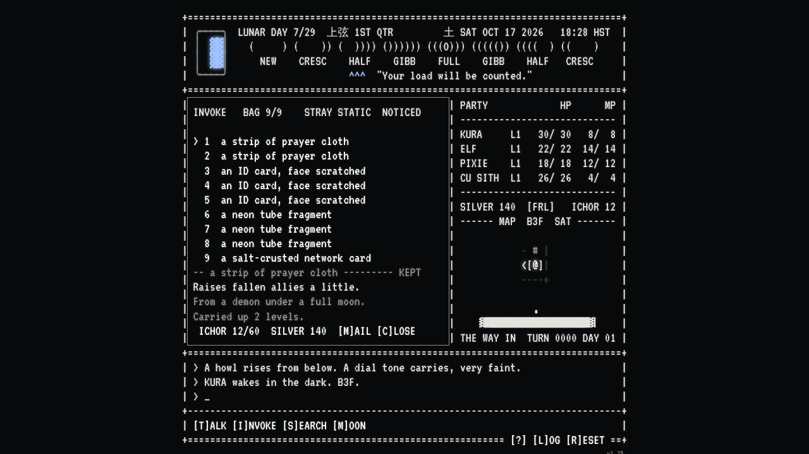

# Daily Digital Demon Dungeon

*One door a day. The dark rises with the moon.*

**Play it:** [okayline.itch.io/4dungeon](https://okayline.itch.io/4dungeon)

An 80-column ASCII dungeon crawler in the spirit of 80s CRPGs and Shin Megami Tensei, played on the real lunar calendar. Open one door a day. The real moon changes how the game plays.

## The Moon Is Real

- **The dark rises with her.** Each quarter of the lunar month, the dark takes a level. Climb out before the quarter ends. Survive all four to finish the cycle, and the game!
- **She sets the mood.** Near the new moon demons are easier to talk to; near the full moon they run wild. Most of the game shifts a little with her phase.
- **Full moons are rarer and stranger.** Some things only turn up under the brightest light.
- **Look up and ask her.** There's no ceiling, only the sky. Some nights she is more talkative than others.
- **Everyone's in the same pit.** Everyone playing this quarter is on the same level with the same rooms. Which door is which is yours alone. The game tells you how many others are down there, never who.

## Good to Know

- **One key a day.** Spend it on one of two doors every day.  Everyone playing has the same choice, but a different context.
- **Breath.** Searching, walking, talking, actions all take breath.  If you're of breath, wait a few seconds.
- **TALK.** Talk to a demon, or to your party. Everyone carries things, and sometimes they'll offer you one. On your own, KURA listens to the room or the door she faces instead.
- **Your party.** Start with three friends. Demons can join when there's room. Talking builds good vibes with them, and they'll go quiet for a day if a room turns loud.
- **Aura.** What you carry, who walks with you and what you've done lately make you louder, and give you a colour. Demons, the dungeon, and the moon can tell.
- **The Omen.** Once a day the moon whispers her Omen, and it tilts what the day brings.
- **The Board.** Post a finished run to the leaderboard. Your run starts under a placeholder name; type your own when you post.
- **Saves.** Your run lives in your browser. The account page ([P]) keeps a save code, passkeys and a cloud save to move it to another device.

## Files

- `index.html`: the page: the screen, keys, boxes, title screen, saves and the `[?]` menu.
- `screen.js`: draws the 80-column screen and keeps time.
- `floor.js`: rolls each level and draws the minimap.
- `rules.js`: the rules.
- `leaderboard/`: the Cloudflare Worker and database behind the board and the title screen's numbers. Its own README covers setup.
- `CHANGELOG.md`: every update, with its time and a screenshot (in `screenshots/`).
- `fonts/`: VT323, with its license (SIL Open Font License).
- `archive/`: retired pieces, kept for history.

Star positions come from the [d3-celestial](https://github.com/ofrohn/d3-celestial) catalog (BSD license, Olaf Frohn).
