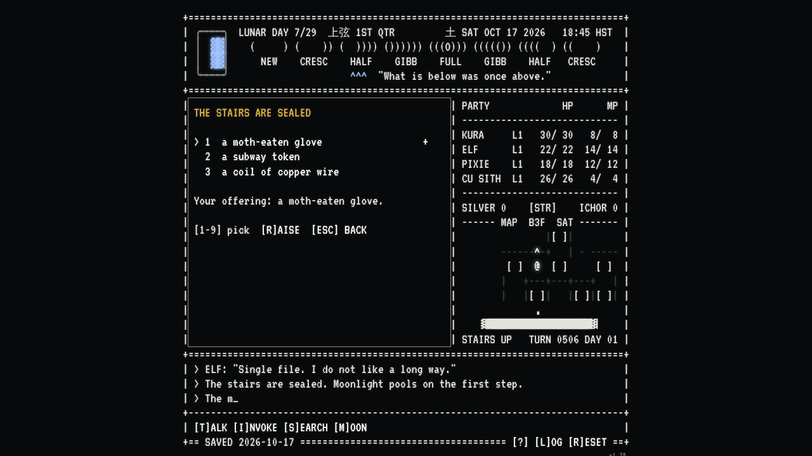

# Daily Digital Demon Dungeon

*One door a day. The dark rises with the moon.*

**Play it:** [dungeon.88x31.app](https://dungeon.88x31.app)

An 80-column ASCII dungeon crawler in the spirit of 80s CRPGs and Shin Megami Tensei with some modern twists.  Played on the real lunar calendar. You wake at the bottom of a pit. The dark is already rising.

Daily Digital Demon Dungeon (4Dungeon) is a daily, asynchronous, moon-phased, time-gated, seeded, real-world-clock-driven, server-authoritative, shared-world, ambient multiplayer, roguelike dungeon crawler with permadeath-style runs, one key a day, sealed stairs, and a public hash-chained ledger keeping track of items with provenance.

## The Moon Is Real

- **The dark rises with her.** Each quarter of the moon, it takes a level. Climb before it takes yours.
- **She sets the mood.** Some nights the demons will listen. Some nights they won't.
- **She wants something.** Look up and ask. She'll tell you, if you know how to listen.
- **The stairs are sealed.** Only she can open them. Show her what you carry.
- **Everyone's in the same pit.** Same level, same rooms, different doors. You'll hear footsteps. You won't see faces.

## Good to Know

- **One key a day.** Two doors. Choose.
- **The walls hide things.** Search, but not too long in one place.
- **Talk.** To demons, to your friends, to the dark. Everyone carries something.
- **Your aura shows.** What you carry and who walks with you. Things notice.
- **Things remember.** Every find has a story, and the [ledger](https://88x31.app/registry) keeps it.
- **One omen a day.** Every one of them is true.

## Files

- `index.html`: the page: the screen, keys, boxes, title screen, account page and the `[?]` menu.
- `screen.js`: draws the 80-column screen and keeps time.
- `floor.js`: rolls each level and draws the minimap.
- `rules.js`: the rules.
- `act.js`: every action the page or the server can take on a run, in one list.
- `sky.js`: the real night sky and moon KURA sees when she looks up.
- `items.js`: the item list, generated from the shared item table (dungeon-items) by `tools/sync-items.mjs`. Don't edit it by hand.
- `leaderboard/`: the Cloudflare Worker and database behind the board, the title screen's numbers, accounts and the server-side run (`game.js`). Its own README covers setup.
- `CHANGELOG.md`: every update, with its time.
- `screenshots/`: screenshots from older builds.
- `fonts/`: VT323, with its license (SIL Open Font License).
- `archive/`: retired pieces, kept for history.

Star positions come from the [d3-celestial](https://github.com/ofrohn/d3-celestial) catalog (BSD license, Olaf Frohn).
